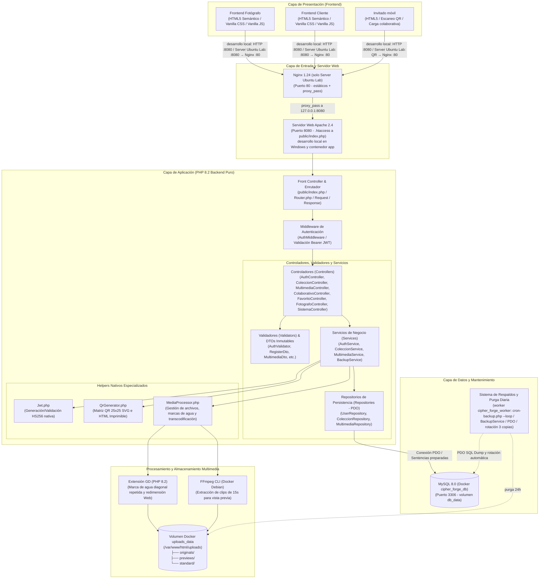
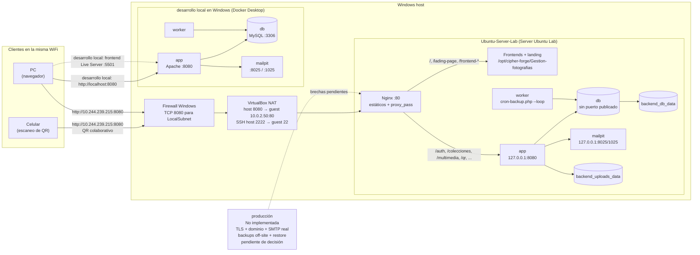
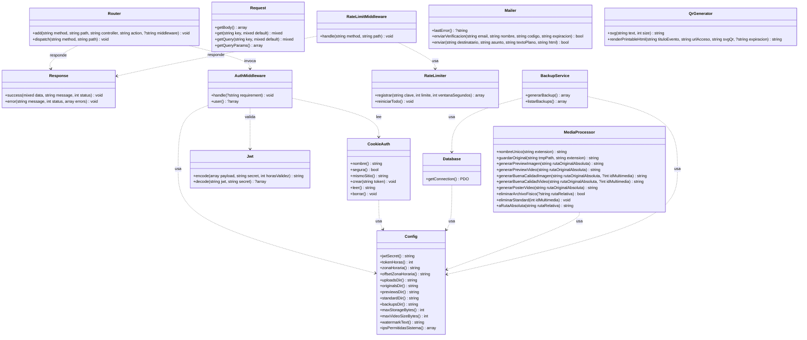
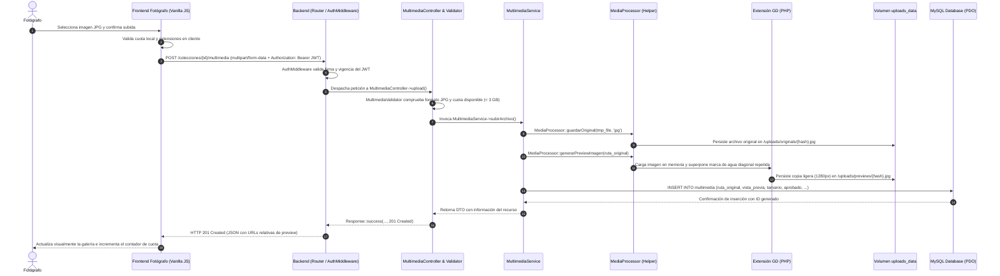
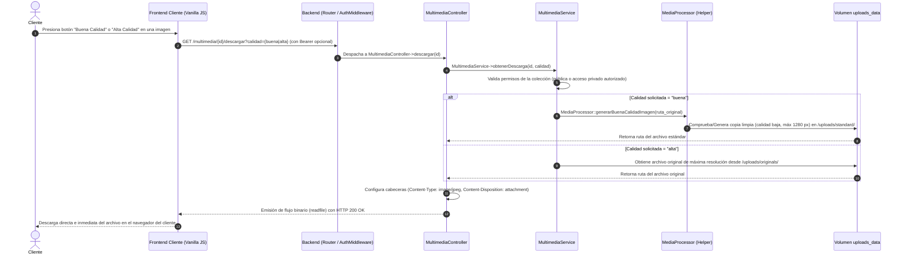

# 2. Arquitectura Propuesta, Modelado y Justificación Tecnológica

---

## 1. Arquitectura Propuesta del Sistema

El sistema **Cipher_Forge** adopta una **arquitectura en capas (Layered Architecture)** basada en el patrón **Cliente-Servidor desacoplado**, donde el frontend (interfaz de usuario) interactúa con el backend exclusivamente a través de una **API RESTful** sobre HTTP emitiendo y recibiendo cargas en formato JSON o binarios multipart. La persistencia de datos reside en un motor relacional MySQL 8.0 y los archivos multimedia se almacenan de forma estructurada en un volumen de almacenamiento persistente montado en el contenedor de la aplicación.

> **Estado de implementación:** la arquitectura lógica es común a todos los entornos, pero el despliegue no. El **desarrollo local en Windows** usa Docker Desktop y Apache publicado en `:8080`. El **Server Ubuntu Lab (laboratorio)** usa la misma aplicación en contenedores detrás de Nginx `:80`, con VirtualBox NAT y port forwarding desde Windows; es una demo/laboratorio en LAN, sin TLS ni dominio. **Producción no está implementada**: depende de las decisiones y brechas de [infraestructura.md, Sección 5](infraestructura.md#5-arquitectura-y-requisitos-de-producción-brechas-no-hechos). La migración a Ubuntu no cambia el ERD ni las 11 tablas.

### 1.1 Diagrama de Arquitectura Global

> En el **desarrollo local en Windows** los clientes entran directo a Apache `:8080`; Nginx solo existe en el **Server Ubuntu Lab** como borde HTTP. El diagrama muestra ambas rutas de entrada para no duplicar la arquitectura lógica.

### 1.2 Estado de Implementación y Diagrama de Despliegue

| Entorno | Estado | Entrada web | Base de datos | Multimedia | Notas |
|---|---|---|---|---|---|
| desarrollo local en Windows | Implementado | Apache `:8080` | `db` con `3306` publicado | Volumen `uploads_data` | Docker Desktop; frontend con Live Server `:5501` |
| Server Ubuntu Lab (laboratorio) | Implementado como demo/laboratorio | Windows `:8080` → VirtualBox NAT → Nginx `:80` → `app` en `127.0.0.1:8080` | `db` sin puerto publicado | Volumen `backend_uploads_data` | Nginx sirve frontends y API en el mismo origen; QR validado desde celular el 28/10/2026 |
| producción | **No implementada** | HTTPS con dominio pendiente de decisión | Gestionada, sin puerto público | Almacenamiento externo o gestionado pendiente de decisión | Requiere TLS, SMTP real, backups off-site y restore probado |

**Despliegue concreto del laboratorio:**

**Lectura del despliegue:**

* **Windows es necesario en NAT:** aporta la IP de la WiFi (`10.244.239.215`) y el port forwarding `8080 → 80`; la VM sola (`10.0.2.50`) no es accesible desde el celular.
* **Nginx es el borde del Server Ubuntu:** sirve la landing y los dos frontends como estáticos y proxya la API a `127.0.0.1:8080`. El backend deja de estar publicado a la LAN y `/sistema/*` se deniega en Nginx.
* **Mismo origen:** al servir frontend y API por el mismo puerto, el navegador no hace CORS y la cookie `SameSite=Strict` funciona. Los dos `config.js` usan `API_URL=""`.
* **Datos persistentes:** `backend_db_data` y `backend_uploads_data` viven en la VM. `docker compose down -v` los destruye; los backups de `backend/backups/` sobreviven en el filesystem de la VM.
* **Mailpit** solo escucha en `127.0.0.1` y se consulta por túnel SSH, no está expuesto a la LAN.
* **Producción** no es una variante de este diagrama: es un entorno pendiente, con TLS, dominio y decisiones sin resolver.

### 1.3 Descripción Detallada de Capas

1. **Capa de Presentación (Frontend):**
   - **Estructura desacoplada:** Dividida en dos portales independientes según el rol del usuario: `frontend-fotografo` (gestión de colecciones, panel de subida con control de cuota de 3 GB, generación de códigos QR y moderación de invitados) y `frontend-cliente` (exploración de colecciones públicas por hashtags, favoritos, acceso privado por token y descarga directa en dos calidades).
   - **HTML5 Semántico:** Marcado riguroso utilizando elementos contextuales (`header`, `main`, `section`, `table`, `form`, `footer`) garantizando accesibilidad y una estructura de código limpia.
   - **Vanilla CSS3 (Sin frameworks externos):** Se descartó expresamente el uso de Bootstrap u otros frameworks CSS. La interfaz se construye con un sistema de diseño propio implementado mediante **Variables CSS (`:root`)** (paleta con acentos verde esmeralda inspirada en OBS Studio), **Flexbox** y **CSS Grid** para la distribución de tarjetas y galerías, cortes angulares con gradientes lineales (`linear-gradient(160deg, ...)`) y **Media Queries** nativas para adaptabilidad total (Responsive) en dispositivos móviles y de escritorio.
   - **Vanilla JavaScript:** Programación asíncrona mediante la API nativa `fetch` con `async/await`, manipulación directa del DOM sin intermediarios (sin jQuery ni frameworks SPA), almacenamiento local con `localStorage` (sesión del usuario, estado de la política de privacidad de la Ley 18.331 y caché de colecciones) y consumo de APIs estándar del navegador (`URLSearchParams`, `FileReader` para carga preliminar).

2. **Capa de Enrutamiento y Control de Acceso (Front Controller & Middleware):**
   - Apache redirige todas las peticiones entrantes hacia `public/index.php` utilizando la directiva `mod_rewrite` del archivo `.htaccess`.
   - **Autoloading PSR-4 nativo:** En `public/index.php`, una función `spl_autoload_register` mapea dinámicamente los namespaces bajo `App\` a la jerarquía física de `src/`, prescindiendo de Composer y evitando carpetas `vendor/` pesadas.
   - El componente `Router` inspecciona el método HTTP (GET, POST, PUT, DELETE) y la URI normalizada, despachando la ejecución al controlador correspondiente.
   - `AuthMiddleware` intercepta peticiones protegidas (`'auth'`) u opcionales (`'optional'`), validando el encabezado HTTP `Authorization: Bearer <token>` mediante tokens JWT firmados, rechazando peticiones no autorizadas con código `401 Unauthorized` antes de alcanzar los controladores.

3. **Capa de Negocio y Dominio (Services, DTOs, Validators & Helpers):**
   - **DTOs (Data Transfer Objects):** Clases inmutables con propiedades fuertemente tipadas (`readonly`) que estructuran la carga de datos (`RegisterDto`, `LoginDto`, `CreateColeccionDto`, `MultimediaDto`), garantizando la integridad de datos desde la entrada del sistema.
   - **Validators:** Clases especializadas (`AuthValidator`, `ColeccionValidator`, `MultimediaValidator`) que verifican reglas de negocio y restricciones técnicas (formatos RFC de correo electrónico, longitud de claves, extensiones MIME permitidas, límite de 800 MB en video y 3 GB en cuota global). Para que estos límites de aplicación sean los que efectivamente rigen, el runtime PHP del contenedor se alinea vía `php.ini` (`upload_max_filesize=900M`, `post_max_size=1G`, `memory_limit=512M`); antes, el default `2M` de PHP rechazaba fotos >2 MB en el transporte sin llegar al validador (CF-NUEVO/CC-16).
   - **Services:** Implementan la lógica de negocio nuclear (`AuthService`, `ColeccionService`, `MultimediaService`, `BackupService`), coordinando la persistencia con repositorios y la manipulación binaria con helpers.
   - **Helpers Nativos en PHP 8.2 (Sin librerías de terceros):**
     * `Jwt.php`: Generador y validador de tokens HS256 basado en `hash_hmac('sha256', ...)` y codificación Base64Url estándar.
     * `QrGenerator.php`: Algoritmo nativo que calcula la matriz modular QR (25x25 Versión 2) y genera directamente el código en formato vectorial SVG y plantillas HTML con estilos de impresión para eventos (HU4, HU7, HU17).
     * `MediaProcessor.php`: Centraliza la persistencia física de archivos, el cálculo de nombres criptográficos unívocos (`bin2hex(random_bytes(16))`), el estampado de marcas de agua con GD y la transcodificación de video con FFmpeg.

4. **Capa de Acceso a Datos (Repositories):**
   - Implementa el patrón Repository (`UserRepository`, `ColeccionRepository`, `MultimediaRepository`), aislando las sentencias SQL de la lógica de dominio.
   - Conexión relacional gestionada mediante `PDO` (`App\Core\Database`) en modo de reporte de errores `ERRMODE_EXCEPTION`.
   - Utilización estricta de consultas preparadas (`prepared statements`) con vinculación de parámetros tipados, erradicando cualquier vector de Inyección SQL.
   - Soporte transaccional ACID (`beginTransaction()`, `commit()`, `rollBack()`) en operaciones atómicas compuestas (como el registro de usuarios con tablas hijas o la eliminación de colecciones en cascada).

5. **Capa de Almacenamiento, Procesamiento Multimedia y Mantenimiento:**
   - **Librería GD:** Imprime marcas de agua semitransparentes en diagonal de forma repetida sobre copias de previsualización en JPG en el instante de la subida, redimensionando la imagen a un ancho óptimo de 1280 px para visualización rápida en galería. Para la descarga en "Buena Calidad" (CC-24/CC-32), genera una copia limpia sin marca de agua con calidad baja (`CALIDAD_BUENA_JPEG = 10`) y resolución máxima HD (1280 px, `ANCHO_MAX_BUENA_CALIDAD`), reescalando solo si el original la supera, de modo que la diferencia visual con la "Alta Calidad" (sirve el original desde `originals/`) sea evidente.
   - **FFmpeg CLI en Docker:** Se ejecuta desde PHP mediante llamadas seguras por consola (`escapeshellarg`) sobre el binario preinstalado en el contenedor Linux, generando automáticamente un clip representativo de 15 segundos (`-t 15 -preset veryfast`) para la galería de previsualización, reteniendo el archivo original de hasta 800 MB para la descarga directa. En la descarga en "Buena Calidad" de videos (CC-30/CC-32), re-codifica el original con H.264 (libx264) CRF 35, resolución máxima HD 1280 px si el original la supera, audio AAC 96 kbps y `+faststart`, guardando la copia en `uploads/standard/`. Además extrae el **poster** de cada video (fotograma JPG `-frames:v 1` en el segundo 1, o el fotograma 0 si el video es más corto; escala máx. 1280 px) usado como portada de colección cuando esta no tiene imágenes (CC-35).
   - **Filesystem persistente:** Montaje desacoplado en el volumen de Docker `uploads_data`, organizado en los subdirectorios `/uploads/originals/`, `/uploads/previews/` y `/uploads/standard/`.
   - **Respaldos y Purga Automatizada (CF-12):** El servicio `worker` de docker-compose (`cipher_forge_worker`) ejecuta `cron-backup.php --loop` como proceso residente y desacoplado del tráfico web. Realiza (a) **respaldo diario** con `BackupService`: volcado DDL y DML de la base de datos vía PDO directo en `backend/backups/`, registro de la traza de auditoría en la tabla `backups` y rotación FIFO conservando estrictamente las últimas 3 copias (RNF5, RNF6, RNF7 / HU13); y (b) **purga horaria de colaborativos no aprobados > 24 h** (`MultimediaService::purgarExpirados`), borrando filas en `multimedia` y archivos físicos en `uploads/` (RF15 / HU12). Sus intervalos se configuran por entorno (`BACKUP_INTERVAL_SEG=86400`, `PURGE_INTERVAL_SEG=3600`); el controlador `SistemaController` ofrece las mismas tareas vía API (`POST /sistema/backup`, `POST /sistema/limpiar-colaborativos`).

---

## 2. Modelado de Datos (Diagrama Entidad-Relación)

La base de datos relacional MySQL 8.0 estructura la información del sistema garantizando integridad referencial estricta, restricciones unívocas y herencia de roles.

### 2.1 Diagrama Entidad-Relación (Mermaid ERD)

```mermaid
erDiagram
    USUARIOS ||--o| CLIENTES : "es un (hereda)"
    USUARIOS ||--o| FOTOGRAFOS : "es un (hereda)"
    USUARIOS ||--o{ COLECCIONES : "crea y administra"
    USUARIOS ||--o{ FAVORITOS : "marca"
    USUARIOS ||--o{ ACCESO_COLECCIONES : "tiene acceso asignado"
    COLECCIONES ||--o{ FAVORITOS : "es marcada en"
    COLECCIONES ||--o{ MULTIMEDIA : "contiene recursos"
    COLECCIONES ||--o{ QR_TOKENS : "emite tokens"
    COLECCIONES ||--o{ COLECCION_HASHTAGS : "clasificada en"
    COLECCIONES ||--o{ ACCESO_COLECCIONES : "asigna permisos a"
    HASHTAGS ||--o{ COLECCION_HASHTAGS : "asocia temas a"
    USUARIOS {
        int id PK "Identificador unico autoincremental"
        string nombre_completo "Nombre del usuario (max 90 car)"
        string email UK "Correo unico para login (max 60 car)"
        string telefono "Telefono de contacto opcional (max 30 car)"
        boolean email_verificado "Estado de verificacion de casilla (DEFAULT FALSE)"
        string codigo_verificacion "Codigo numerico temporal de validacion"
        datetime codigo_expiracion "Fecha y hora limite del codigo"
        string password_hash "Contrasena hasheada con bcrypt"
        enum rol "Rol asignado: fotografo o cliente. Patrón Single Table Inheritance: la columna rol en usuarios distingue fotógrafos y clientes; tablas clientes y fotógrafos son especializaciones con FK a usuarios.id"
    }
    CLIENTES {
        int id_cliente PK,FK "Referencia a usuarios.id (ON DELETE CASCADE)"
    }
    FOTOGRAFOS {
        int id_fotografo PK,FK "Referencia a usuarios.id (ON DELETE CASCADE)"
        boolean politicas_aceptadas "Aceptacion formal Ley 18.331 (DEFAULT FALSE)"
    }
    COLECCIONES {
        int id PK "Identificador unico autoincremental"
        int fotografo_id FK "Dueno de la coleccion (usuarios.id) (NOT NULL)"
        enum tipo_visibilidad "Visibilidad: privada o publica (DEFAULT privada)"
        string titulo "Titulo de la coleccion (max 60 car)"
        string descripcion "Descripcion del evento (max 90 car)"
        timestamp creado_en "Fecha y hora de creacion automatica (DEFAULT CURRENT_TIMESTAMP)"
    }
    MULTIMEDIA {
        int id_multimedia PK "Identificador unico autoincremental"
        int coleccion_id FK "Coleccion contenedora (colecciones.id)"
        string titulo "Titulo del recurso (max 60 car)"
        string descripcion "Detalle del recurso (max 90 car)"
        string ruta_original "Ruta del archivo original en disco"
        string vista_previa "Ruta de la vista previa procesada"
        string poster "Ruta del poster del video (DEFAULT NULL)"
        bigint tamanio "Tamano exacto del archivo original en bytes"
        boolean es_invitado "Indica si fue aportada via QR por un invitado (DEFAULT FALSE)"
        boolean aprobado "Estado de moderacion: TRUE = aprobado, FALSE = pendiente de revision por el fotografo (DEFAULT TRUE)"
        enum tipo "Tipo de recurso: video o imagen"
        timestamp creado_en "Fecha y hora de subida (DEFAULT CURRENT_TIMESTAMP)"
    }
    ACCESO_COLECCIONES {
        int usuario_id PK,FK "Usuario con acceso (usuarios.id)"
        int coleccion_id PK,FK "Coleccion asignada (colecciones.id)"
    }
    FAVORITOS {
        int usuario_id PK,FK "Usuario que marca (usuarios.id)"
        int favorito_id PK,FK "Coleccion publica marcada (colecciones.id)"
    }
    QR_TOKENS {
        int id_token PK "Identificador unico autoincremental"
        int coleccion_id FK "Coleccion asociada (colecciones.id)"
        string token UK "Cadena alfanumerica unica (max 100 car)"
        enum tipo "Tipo de token: colaborativo o acceso"
        timestamp creacion_token "Fecha y hora de generacion (DEFAULT CURRENT_TIMESTAMP)"
        datetime expiracion "Fecha de caducidad (24h para colaborativo, NULL para acceso)"
    }
    HASHTAGS {
        int id_hashtags PK "Identificador unico autoincremental"
        string nombre_hashtags UK "Nombre univoco del tag (max 40 car)"
    }
    COLECCION_HASHTAGS {
        int id_hashtags PK,FK "Hashtag asociado (hashtags.id_hashtags)"
        int coleccion_id PK,FK "Coleccion vinculada (colecciones.id)"
    }
    BACKUPS {
        int id_backup PK "Identificador unico autoincremental"
        string ruta_backup "Ruta del archivo .sql en disco"
        string nombre_backup "Nombre con marca de tiempo del backup"
        timestamp fecha_backup "Fecha y hora exacta del respaldo (DEFAULT CURRENT_TIMESTAMP)"
    }
```

### 2.2 Diagrama de Clases UML (Mermaid Class Diagram)

> **Nota de lectura:** se listan los métodos públicos de negocio; se omiten constructores, miembros privados, propiedades y valores por defecto de los parámetros. Las relaciones se derivan de las instanciaciones (`new`) y de los tipos de retorno reales del código.

**1. Capa de presentación (controladores)**

```mermaid
classDiagram
    class AuthController {
        +register() void
        +login() void
        +logout() void
        +verificarEmail() void
        +reenviarCodigo() void
    }
    class ColeccionController {
        +create() void
        +listarPublicas() void
        +listarMias() void
        +detalle(string id) void
        +validarInvitacion(string token) void
        +canjearInvitacion(string token) void
        +listarHashtags() void
        +actualizar(string id) void
        +eliminar(string id) void
        +actualizarHashtags(string id) void
    }
    class ColaborativoController {
        +generar(string id) void
        +generarAcceso(string id) void
        +imprimir(string id) void
        +svg(string token) void
        +verificar(string token) void
        +subir(string token) void
    }
    class FavoritoController {
        +agregar(string id) void
        +quitar(string id) void
        +listar() void
    }
    class FotografoController {
        +aceptarPoliticas() void
        +directorio() void
        +perfil(string id) void
        +actualizarPerfil() void
        +cuota() void
    }
    class HomeController {
        +ping() void
    }
    class MultimediaController {
        +upload(string coleccionId) void
        +vistaPrevia(string idMultimedia) void
        +poster(string idMultimedia) void
        +original(string idMultimedia) void
        +descargar(string idMultimedia) void
        +eliminar(string idMultimedia) void
        +actualizar(string idMultimedia) void
        +listarPendientes(string coleccionId) void
        +aprobarColaborativo(string coleccionId) void
        +rechazarColaborativo(string coleccionId) void
        +listar(string coleccionId) void
    }
    class SistemaController {
        +backup() void
        +listarBackups() void
        +limpiarColaborativos() void
    }
```

**2. Capa de negocio y persistencia (servicios, repositorios, validadores, DTO y modelos)**

```mermaid
classDiagram
    class AuthService {
        +register(RegisterDto dto) array
        +login(LoginDto dto) array
        +verificarEmail(string email, string codigo) array
        +reenviarCodigo(string email) array
    }
    class ColeccionService {
        +create(CreateColeccionDto dto, array hashtags) array
        +listarMias() array
        +listarPublicas(string hashtag) array
        +obtenerDetalle(int id) array
        +validarInvitacion(string token) array
        +canjearInvitacion(string token) array
        +listarHashtags() array
        +actualizarHashtags(int id, array hashtags) array
        +actualizar(int id, array campos, array hashtags) array
        +eliminar(int id) void
    }
    class MultimediaService {
        +upload(MultimediaDto dto, array archivo, string extension, string mime, bool aprobado) array
        +uploadMultiple(int coleccionId, array archivos, array data, array extensionesPorMime) array
        +obtenerVistaPrevia(int idMultimedia) string
        +obtenerOriginal(int idMultimedia) string
        +obtenerDescarga(int idMultimedia, string calidad) string
        +obtenerPoster(int idMultimedia) string
        +eliminar(int idMultimedia) void
        +actualizarMetadatos(int idMultimedia, array data) array
        +listarPendientes(int coleccionId) array
        +aprobarColaborativo(int coleccionId, array ids) int
        +rechazarColaborativo(int coleccionId, array ids) int
        +purgarExpirados() int
        +listarColeccion(int coleccionId) array
    }

    class UserRepository {
        +findByEmail(string email) ?User
        +findById(int id) ?User
        +create(RegisterDto dto, string hashedPassword) int
        +guardarCodigoVerificacion(string email, string codigo, string expiracion) bool
        +obtenerCodigoVerificacion(string email) ?array
        +marcarEmailVerificado(string email) bool
        +aceptarPoliticas(int fotografoId) bool
        +politicasAceptadas(int fotografoId) bool
        +actualizarPerfilFotografo(int fotografoId, string nombre, ?string telefono) bool
        +listarFotografos() array
        +obtenerPerfilFotografo(int id) ?Fotografo
    }
    class ColeccionRepository {
        +create(CreateColeccionDto dto) int
        +findById(int id) ?Coleccion
        +listarPublicas(?string hashtag) array
        +listarPorFotografo(int fotografoId) array
        +listarMiasConPortada(int fotografoId) array
        +actualizar(int id, string titulo, ?string descripcion, string tipoVisibilidad) bool
        +sincronizarHashtags(int coleccionId, array nombresHashtags) void
        +obtenerHashtags(int coleccionId) array
        +contarArchivos(int coleccionId) int
        +listarHashtags() array
        +crearTokenColaborativo(int coleccionId, string expiracion) TokenQr
        +crearTokenAcceso(int coleccionId) TokenQr
        +buscarTokenAccesoVigente(int coleccionId) ?TokenQr
        +buscarToken(string token) ?TokenQr
        +otorgarAcceso(int usuarioId, int coleccionId) bool
        +obtenerRutasMultimediaDeColeccion(int coleccionId) array
        +eliminarFavoritosPorColeccion(int coleccionId) void
        +eliminarConDependencias(int coleccionId) void
    }
    class MultimediaRepository {
        +create(MultimediaDto dto, string rutaOriginal, string vistaPrevia, int tamanio, bool aprobado, ?string poster) int
        +actualizarPoster(int id, string rutaPoster) bool
        +findById(int id) ?Multimedia
        +findByColeccionId(int coleccionId, bool soloAprobados) array
        +espacioUsadoPorFotografo(int fotografoId) int
        +delete(int id) bool
        +actualizarMetadatos(int id, string titulo, ?string descripcion, ?int nuevaColeccionId) bool
        +listarPendientes(int coleccionId) array
        +aprobarMultiples(array ids, int coleccionId) int
        +obtenerRutasPorIds(array ids, int coleccionId) array
        +purgarNoAprobadosExpirados() array
        +tieneAcceso(int usuarioId, int coleccionId) bool
    }

    class AuthValidator {
        +validateRegister(array data) RegisterDto
        +validateLogin(array data) LoginDto
    }
    class ColeccionValidator {
        +validateCreate(array data) CreateColeccionDto
        +validateUpdate(array data) array
        +validateHashtags(array hashtags) array
    }
    class MultimediaValidator {
        +checkUpload(array archivo, array data, int coleccionId, bool esInvitado) array
        +validateUpload(array archivo, array data, int coleccionId, bool esInvitado) MultimediaDto
        +validateUpdate(array data) array
    }

    class RegisterDto
    class LoginDto
    class CreateColeccionDto
    class MultimediaDto

    class User {
        +toArray() array
    }
    class Cliente {
        +toArray() array
    }
    class Coleccion {
        +toArray() array
    }
    class Fotografo {
        +toArray() array
    }
    class Multimedia {
        +toArray() array
    }
    class TokenQr {
        +toArray() array
    }

    AuthService --> UserRepository : usa
    AuthService ..> RegisterDto : recibe
    AuthService ..> LoginDto : recibe
    ColeccionService --> UserRepository : usa
    ColeccionService --> ColeccionRepository : usa
    ColeccionService --> MultimediaRepository : usa
    ColeccionService ..> CreateColeccionDto : recibe
    MultimediaService --> MultimediaRepository : usa
    MultimediaService --> ColeccionRepository : usa
    MultimediaService --> UserRepository : usa
    MultimediaService ..> MultimediaDto : recibe
    AuthValidator ..> RegisterDto : crea
    AuthValidator ..> LoginDto : crea
    ColeccionValidator ..> CreateColeccionDto : crea
    MultimediaValidator ..> MultimediaDto : crea
    UserRepository ..> User : retorna
    UserRepository ..> Fotografo : retorna
    ColeccionRepository ..> Coleccion : retorna
    ColeccionRepository ..> TokenQr : crea
    MultimediaRepository ..> Multimedia : retorna
```

**3. Capa de infraestructura y soporte (núcleo, middlewares y helpers)**

**Dependencias entre capas (confirmadas en el código):**

- `AuthController` instancia `AuthService`, `AuthValidator` y `Request`; usa `CookieAuth` en el logout.
- `ColeccionController` instancia `ColeccionService`, `ColeccionValidator` y `Request`.
- `MultimediaController` instancia `MultimediaService`, `MultimediaValidator` y `Request`.
- `ColaborativoController` instancia `ColeccionRepository`, `MultimediaRepository`, `UserRepository`, `MultimediaService`, `MultimediaValidator` y `Request`; usa `QrGenerator`, `AuthMiddleware` y `Config`.
- `FavoritoController` y `FotografoController` instancian repositorios y `Request`; usan `AuthMiddleware`.
- `SistemaController` instancia `BackupService` y `MultimediaService`.
- Los servicios instancian `Database` y sus repositorios; `AuthService` usa `Jwt`, `Mailer` y `CookieAuth`; `ColeccionService` y `MultimediaService` usan `MediaProcessor`.

### 2.3 Decisiones de Diseño en el Modelo

* **Jerarquía de Usuarios (Herencia de Tablas):** La tabla `usuarios` concentra las credenciales de acceso, la verificación por código y el rol. Las tablas especializadas `fotografos` (con la bandera de aceptación formal de la Ley 18.331 en primer login, HU31) y `clientes` referencian a `usuarios.id` con eliminación en cascada (`ON DELETE CASCADE`). Esta estructura elimina redundancias y garantiza que una cuenta no pueda duplicar su correo electrónico en roles simultáneos.
* **Separación de Archivo Original y Vista Previa:** La entidad `multimedia` mantiene dos rutas físicas diferenciadas: `ruta_original` (archivo fuente de máxima resolución, inaccesible directamente por URL para evitar robo de contenido) y `vista_previa` (copia optimizada con marca de agua semitransparente o videoclip de 15 segundos para la visualización en el navegador).
* **Ciclo de Vida y Moderación Colaborativa (RF14, RF15):** Los atributos `es_invitado` y `aprobado` en `multimedia` permiten que las cargas de invitados ingresen con `aprobado = FALSE`. El fotógrafo puede auditar estos archivos en su panel de moderación; los archivos no aprobados que superen las 24 horas desde `creado_en` son depurados automáticamente por la rutina del sistema.
* **Tokens QR Efímeros vs. Permanentes:** La entidad `qr_tokens` gestiona tanto el QR colaborativo de eventos (tipo `'colaborativo'`, con expiración a las 24 horas para subida anónima) como el QR de acceso permanente (tipo `'acceso'`, con expiración nula) que permite a clientes autorizados acceder a colecciones privadas.
* **Descarga Directa en Dos Calidades (Control de Cambios CC-01):** Conforme al Control de Cambios CC-01, se eliminó del modelo de base de datos la persistencia de solicitudes intermedias y notificaciones de autorización. La descarga opera de manera directa e individual en dos calidades ("Buena Calidad" = copia con calidad baja y tope HD 1280 px y "Alta Calidad" = original) mediante `GET /multimedia/{id}/descargar?calidad={buena|alta}`, simplificando el modelo relacional y optimizando la experiencia de usuario sin fricciones.
* **Modelo de Datos Actualizado:** El ERD ahora refleja fielmente el esquema de base de datos incluyendo el campo `poster` en la entidad `MULTIMEDIA` y las restricciones NOT NULL y DEFAULT correspondientes a cada campo, asegurando consistencia entre el modelo conceptual y la implementación física.
* **Router y Despacho de Controladores (EF-ARQ-01):** El componente `Router` despacha peticiones HTTP a los controladores correspondientes (`AuthController`, `ColeccionController`, `MultimediaController`, `ColaborativoController`, `FavoritoController`, `FotografoController`, `SistemaController`) según las rutas definidas en `backend/routes.php`. Esta relación no se representa como una clase en el diagrama UML porque los controladores son entidades independientes, no subclases de `Router`.
* **Configuraciones Compartidas (CC-16):** `Config` es una clase de utilidad central que provee `maxStorageBytes()` y `backupsDir()`. `MediaProcessor` la usa para rutas de almacenamiento y límites de cuota (3 GB); `BackupService` la usa para el directorio de respaldos; `MultimediaService` la consulta para validar cuotas. Estas dependencias están documentadas en el diagrama de clases UML.
* **Claves Primarias Compuestas:** Las tablas `favoritos`, `acceso_colecciones` y `coleccion_hashtags` utilizan claves primarias compuestas (`(usuario_id, favorito_id)`, `(usuario_id, coleccion_id)`, `(id_hashtags, coleccion_id)` respectivamente) definidas explícitamente en `schema.sql` con `PRIMARY KEY (campo1, campo2)`. El ERD las representa con `PK,FK` en cada campo para indicar su participación en la clave compuesta.
* **Restricción de Favoritos Públicos (CC-15):** La tabla `favoritos` tiene una restricción semántica (documentada como comentario en `schema.sql`) que indica que los favoritos apuntan exclusivamente a colecciones públicas completas (RF21), no a archivos individuales ni colecciones privadas. El campo `favorito_id` referencia `colecciones(id)` y la lógica de negocio en `FavoritoController` debe validar que la colección sea pública antes de permitir el marcado.
* **NOT NULL Explícito en colecciones.fotografo_id:** La columna `fotografo_id` en la tabla `colecciones` está definida como `INT NOT NULL` en `schema.sql`. El ERD la muestra como FK sin NOT NULL explícito en su descripción, pero la implementación física garantiza que toda colección debe tener un fotógrafo propietario asignado.

---

## 3. Flujos de Información y Comunicación

### 3.1 Flujo de Subida y Procesamiento de Imágenes

El siguiente diagrama detalla la secuencia exacta desde que el fotógrafo selecciona una imagen hasta que la vista previa con marca de agua queda disponible en la galería:

### 3.2 Flujo de Descarga Directa en Dos Calidades (Post-CC-01)

Conforme a las decisiones del equipo registradas en [08_control_de_cambios.md](08_control_de_cambios.md) (CC-01 y CC-02), la descarga opera de forma directa e individual sin requerir aprobación diferida:

---

## 4. Justificación Tecnológica

A continuación se fundamenta la selección técnica del stack de **Cipher_Forge**, analizando sus ventajas de arquitectura, la portabilidad del entorno y los motivos pedagógicos y técnicos por los cuales se descartaron tecnologías alternativas.

| Componente | Tecnología Seleccionada | Justificación Técnica | Alternativas Descartadas y Motivo |
| :--- | :--- | :--- | :--- |
| **Backend** | **PHP 8.2 (Vanilla OOP con PSR-4 nativo)** | Tipado estricto (`declare(strict_types=1)`), manejo robusto de excepciones y soporte nativo de extensiones para flujos de datos binarios y procesamiento de imágenes. Un autoloader PSR-4 escrito desde cero mediante `spl_autoload_register` garantiza portabilidad total y despliegue rápido sin requerir herramientas intermedias. | **Node.js / Express:** Mayor complejidad para el manejo eficiente de streams binarios pesados (imágenes de alta resolución y videos de hasta 800 MB) en entornos locales sin colas dedicadas. **Laravel / Symfony:** Sobrecarga innecesaria de dependencias y falta de conocimientos tecnológicos para defenderlo ante los evaluadores de UTU. |
| **Servidor Web** | **Apache 2.4 con mod_rewrite + Nginx 1.24 como borde en Server Ubuntu** | Apache mantiene la integración nativa con PHP vía `mod_php` en la imagen oficial y la canalización de rutas con `.htaccess` hacia `public/index.php`. En el **Server Ubuntu Lab** se antepone Nginx para servir frontends y landing como estáticos, proxear la API a `127.0.0.1:8080` y unificar el origen: eso elimina CORS en el navegador, permite `SameSite=Strict` y hace que el QR use una única URL pública. Nginx también deniega `/backend`, `/docs`, `/sistema` y extensiones sensibles. | **Nginx + PHP-FPM como reemplazo total:** buen desempeño en alta concurrencia, pero exige administrar dos procesos y cambiar la imagen/base del proyecto; no se adoptó. **Publicar Apache directo a la LAN:** obliga a CORS entre puertos, expone el backend y complica las cookies y el QR; se descartó para el laboratorio. |
| **Frontend** | **HTML5 Semántico, Vanilla CSS y Vanilla JavaScript** | **HTML5 Semántico:** Estructuración accesible y limpia de la interfaz. **Vanilla CSS:** Control milimétrico de la apariencia mediante Variables CSS (`:root`), Flexbox y Grid, evitando conflictos de especificidad o carga de estilos innecesarios. **Vanilla JS:** Empleo nativo de `fetch`, Promesas, `async/await`, manipulación directa del DOM y `localStorage`, garantizando comprensión integral del código línea por línea sin intermediarios. | **Bootstrap 5 / Tailwind:** Descartados para evitar el peso muerto de hojas de estilo prefabricadas con clases genéricas y dependencias externas que restan mérito a la maquetación propia del equipo. **React / Vue / Angular:** Requerirían un entorno de compilación adicional (Node.js, Vite, npm) que desvía el foco del proyecto de los fundamentos de red, seguridad y arquitectura cliente-servidor. |
| **Helpers Nativos (Seguridad y QR)** | **PHP Puro sin Composer (`Jwt.php` y `QrGenerator.php`)** | Máxima independencia tecnológica: la generación de tokens JWT HS256 mediante `hash_hmac` y la construcción de la matriz modular QR en SVG vectorial se programaron algorítmicamente en PHP puro, logrando un backend liviano, seguro y sin dependencias de paquetes externos. | **Librerías Composer (`firebase/php-jwt`, `endroid/qr-code`):** Descartadas para eliminar riesgos asociados a la cadena de suministros, evitar dependencias de Composer en la entrega y demostrar solvencia algorítmica ante UTU. |
| **Base de Datos** | **MySQL 8.0 Relacional** | Soporte estricto para transacciones ACID, integridad referencial (`FOREIGN KEY` con `ON DELETE CASCADE`), tipos ENUM para roles y visibilidad, y funciones de agregación para el cómputo exacto de cuotas de almacenamiento en bytes. | **PostgreSQL:** Prestaciones similares, pero MySQL ofrece mayor compatibilidad directa con las herramientas didácticas y el entorno curricular de UTU. **MongoDB:** Descartado categóricamente debido a la naturaleza estrictamente relacional de las colecciones, permisos de usuario y auditoría de eventos. |
| **Procesamiento de Video** | **FFmpeg en Contenedor Docker** | Herramienta líder a nivel industrial para manipulación y transcodificación audiovisual. Permite recortar clips ligeros de 15 segundos sin saturar la memoria RAM del servidor web, aislando los códecs en la capa del contenedor Linux. | **Librerías JavaScript en el cliente:** Técnicamente incapaces de procesar videos de hasta 800 MB sin bloquear el hilo principal y saturar la memoria del navegador del usuario. |
| **Contenedores y Despliegue** | **Docker & Docker Compose + VirtualBox NAT en el laboratorio** | Garantiza paridad entre los entornos de desarrollo y la computadora de evaluación del tribunal de UTU. Un solo comando (`docker compose up`) levanta la base de datos, el servidor Apache con PHP 8.2 y los binarios de FFmpeg. En el **Server Ubuntu Lab**, Docker Compose corre dentro de la VM `Ubuntu-Server-Lab` y VirtualBox NAT con port forwarding `8080 → 80` permite que el celular acceda por la IP de Windows. La misma imagen y el mismo código se reutilizan; solo cambia la configuración del borde (Nginx) y el `.env`. | **Instalaciones locales con XAMPP / WampServer:** Fuente constante de conflictos por discrepancias entre versiones de PHP/MySQL en los sistemas Windows de los alumnos, sumado a la carencia de FFmpeg preinstalado. **Servidor físico dedicado:** descartado para esta etapa por costo y por no aportar nada a la demo; la VM en NAT es suficiente para el laboratorio, aunque depende de que Windows esté encendido. |
