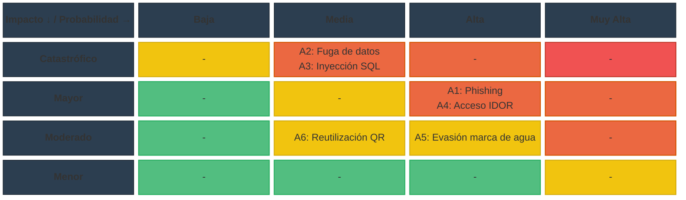
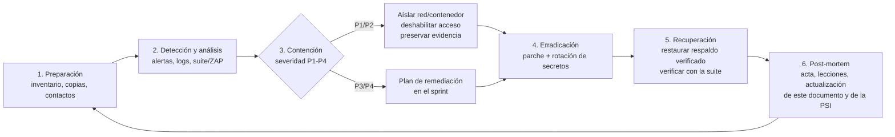

# Requerimientos de la Unidad Curricular: Ciberseguridad
**Proyecto de Egreso – BT 3° Tecnologías de la Información**
**Ana Victoria Reyes Macedo**

---

## Introducción

Cada grupo deberá integrar aspectos teóricos y prácticos de ciberseguridad
dentro del desarrollo de su Proyecto de Egreso. Esta integración no será un componente
adicional, sino una dimensión transversal que debe estar presente desde la planificación
inicial hasta la implementación y evaluación final del sistema.

Será evaluado tanto el uso efectivo de herramientas profesionales, como la
documentación técnica, el análisis crítico, la aplicación de buenas prácticas y la
reflexión ética. Cada entrega parcial contará con una calificación específica, y su
contenido deberá integrarse dentro del documento general del proyecto, siguiendo el
formato establecido.

---

# Primera Entrega – Análisis y Diseño Seguro


## Objetivo: Detectar amenazas desde la etapa inicial del proyecto y proponer mecanismos preventivos adecuados.


## 1. Identificación de al menos 3 amenazas digitales relevantes.

1.1 Phishing dirigido a fotógrafos y clientes

El sistema almacena datos de contacto (correo y teléfono) y gestiona el acceso a colecciones privadas y a la descarga de material pagado a futuro. Un atacante podría suplantar al sistema o al fotógrafo mediante correos falsos (por ejemplo, notificaciones falsas de "nueva colección disponible" o "verificación de cuenta") para robar credenciales de acceso. Dado que el rol Fotógrafo administra colecciones privadas y autoriza clientes manualmente, el robo de sus credenciales comprometería la confidencialidad de todo su material y de los datos de sus clientes.

1.2 Inyección SQL 

El sistema cuenta con múltiples formularios que interactúan con la base de datos: registro de usuarios (RF1, RF2), inicio de sesión (RF3), creación de colecciones (RF4), carga de metadatos de imágenes/videos (RF7, RF20) y validación de códigos QR (RF13-RF17). Si estas entradas no se validan ni se usan consultas parametrizadas, un atacante podría inyectar código SQL para leer, modificar o eliminar datos de usuarios, colecciones o permisos de descarga, representando un riesgo crítico dado que la base de datos contiene datos personales.

1.3 Fuga de datos personales

El RF1 dice que el sistema debe permitir registrar nombre completo, correo electrónico, contraseña y número de teléfono como opcional tanto de fotógrafos como de clientes. Una fuga de esta base de datos (por configuración insegura del entorno en la nube, respaldo mal protegido o error humano) expondría información de identificación personal, lo que además de un daño reputacional para el proyecto implicaría un problema legal y ético para el equipo, dado que se trata de datos sensibles de terceros.

1.4 Acceso no autorizado a colecciones privadas (IDOR)

Según RF5 y RF6, las colecciones privadas solo deben ser visibles para los clientes que el fotógrafo autorizó explícitamente, y el sistema debe bloquear el acceso directo por URL. Si la autorización se valida únicamente en el frontend, o si los identificadores de colección son predecibles y no se verifica en el backend que el usuario autenticado tenga permiso sobre ese recurso específico (vulnerabilidad de tipo IDOR — Insecure Direct Object Reference), cualquier usuario podría acceder a material privado de otro cliente simplemente cambiando un identificador en la URL.

1.5 Evasión de la marca de agua y descarga no autorizada

El modelo de negocio del cliente depende de que las imágenes en vista previa tengan marca de agua y que solo el contenido autorizado se entregue sin ella (restricción técnica confirmada en la entrevista, RF9, RF11). Si el archivo de alta calidad queda accesible por una URL directa no protegida, o si la marca de agua se aplica solo de forma visual sin proteger el archivo original en el servidor, un usuario podría descargar el material sin haber sido autorizado, afectando directamente el objetivo de negocio del cliente (cobro ágil por el material).

1.6 Abuso o reutilización de códigos QR

El sistema usa códigos QR con dos propósitos distintos: acceso directo a una colección (RF16) y carga colaborativa de contenido por parte de invitados sin cuenta (RF13, RF14). Si estos códigos no expiran, no están vinculados a un evento/colección específica o pueden reutilizarse indefinidamente, un tercero que obtenga el QR (por ejemplo, fotografiándolo en un evento) podría subir contenido no deseado a la colección o acceder a material privado fuera del contexto para el que fue generado.

---

## 2. Mapa de Riesgos

El siguiente esquema vincula los componentes principales del sistema con las amenazas identificadas, permitiendo visualizar qué partes del sistema concentran mayor exposición.


 
*Rojo = Impacto Alto (técnico y a usuarios) · Naranja = Impacto Medio*
 
---
 
## Escala de valoración de riesgo
 
| Nivel | Probabilidad | Impacto | Resultado (R) | Acción Inmediata |
|---|---|---|---|---|
| **Crítico** | Muy Alta (4-5) | Catastrófico (4-5) | 16 - 25 | Detener operaciones / Mitigación urgente |
| **Alto** | Alta (3) | Mayor (3) | 9 - 15 | Planes de acción correctiva a corto plazo |
| **Medio** | Media (2) | Moderado (2) | 4 - 8 | Monitoreo periódico y controles programados |
| **Bajo** | Baja (1) | Menor (1) | 1 - 3 | Asumir el riesgo / Monitoreo mínimo |
 
*R = Probabilidad × Impacto*
 
---
 
## Amenazas identificadas — valoración aplicada
 
Tabla construida a partir de las conexiones reales del Mapa de Riesgos (componentes del sistema → amenazas detectadas).
 
| Amenaza | Componente(s) afectado(s) | Probabilidad | Impacto | R | Nivel | Acción Inmediata |
|---|---|---|---|---|---|---|
| Phishing dirigido a fotógrafos y clientes | Registro e inicio de sesión de usuarios | Alta (3) | Mayor (3) | 9 | **Alto** | Planes de acción correctiva a corto plazo |
| Fuga de datos personales (contactos, nombres) | Base de datos de usuarios | Media (2) | Catastrófico (5) | 10 | **Alto** | Planes de acción correctiva a corto plazo |
| Inyección SQL en formularios y filtros | Base de datos de usuarios · Carga de imágenes y videos | Media (2) | Catastrófico (5) | 10 | **Alto** | Planes de acción correctiva a corto plazo |
| Acceso no autorizado a colecciones privadas (IDOR) | Gestión de colecciones · Acceso y carga vía código QR | Alta (3) | Mayor (3) | 9 | **Alto** | Planes de acción correctiva a corto plazo |
| Evasión de marca de agua / descarga no autorizada | Vista previa con marca de agua | Alta (3) | Moderado (2) | 6 | **Medio** | Monitoreo periódico y controles programados |
| Abuso o reutilización de códigos QR | Acceso y carga vía código QR | Media (2) | Moderado (2) | 4 | **Medio** | Monitoreo periódico y controles programados |

---
 
### Notas de justificación
 
- **Fuga de datos personales** e **Inyección SQL** se clasifican como Alto por su impacto catastrófico: ambas comprometen directamente la base de datos de usuarios, que contiene nombres completos, correos y teléfonos reales de fotógrafos y clientes.
- **Phishing** se clasifica como Alto por su alta probabilidad: es el vector de ataque más simple de ejecutar contra el punto de registro/inicio de sesión, sin requerir explotar una falla técnica del sistema.
- **Acceso no autorizado a colecciones privadas (IDOR)** se clasifica como Alto porque dos componentes distintos convergen en esta amenaza (Gestión de colecciones y Acceso vía QR), lo que aumenta su probabilidad de ocurrencia.
- **Evasión de marca de agua** y **Abuso de código QR** quedan en Medio: su impacto afecta principalmente el modelo de negocio del fotógrafo, pero su explotación depende de condiciones más puntuales (acceso al archivo original o al QR físico).

---
 
## Análisis de impacto (técnico y sobre los usuarios)
 
| Amenaza | Impacto técnico | Impacto sobre los usuarios |
|---|---|---|
| Phishing dirigido a fotógrafos y clientes | Robo de información; compromiso de cuentas de Fotógrafo o Cliente | Suplantación de identidad; pérdida de confianza en la plataforma |
| Fuga de datos personales (Contactos y Nombres) | Pérdida de confidencialidad del almacenamiento en la nube | Exposición de nombre completo, correo y teléfono de usuarios reales |
| Inyección SQL en formularios y filtros | Alteración o destrucción de datos; posible caída del servicio | Exposición de datos personales de todos los usuarios registrados |
| Acceso no autorizado a colecciones privadas (IDOR) | Bypass de la lógica de autorización del backend | Exposición de material privado de clientes y eventos ajenos |
| Evasión de marca de agua / descarga no autorizada | Acceso directo al archivo original sin control de permisos | Pérdida económica para el fotógrafo (afecta el objetivo de negocio) |
| Abuso o reutilización de códigos QR | Carga de contenido no controlado; acceso fuera del contexto previsto | Contenido indebido en la colección; exposición no deseada de material |

---

## 3. Buenas prácticas de seguridad en desarrollo web

Resumen las buenas prácticas durante el desarrollo, seleccionadas y justificadas en función de las amenazas concretas identificadas para este proyecto.

## 3.1 Validación y saneamiento de entradas

Todo dato ingresado por el usuario (formularios de registro, título/descripción de imágenes, parámetros de búsqueda) se validará y saneará tanto en el frontend como en el backend, y las consultas a la base de datos se realizarán mediante sentencias parametrizadas u ORM, nunca concatenando texto. Esta práctica ataca directamente el riesgo de inyección SQL (1.2) descrito arriba, que es crítico por la cantidad de formularios con los que cuenta el sistema.

---

## 3.2 Autenticación robusta y gestión segura de sesiones

Las contraseñas se almacenarán con un algoritmo de hash con salting (bcrypt), nunca en texto plano ni con hashes reversibles. Las sesiones utilizarán tokens con expiración y se invalidarán al cerrar sesión. Esta práctica reduce el impacto de un eventual phishing (1.1), ya que aunque se filtre un correo o usuario, la contraseña no queda expuesta directamente en la base de datos.


---

## 3.3 Control de acceso verificado en el backend (no solo en la interfaz)

Cada endpoint que devuelve una colección, imagen o dato de usuario deberá verificar en el servidor que el solicitante tiene permiso sobre ese recurso puntual, usando identificadores no predecibles (UUID en lugar de IDs incrementales) para colecciones privadas. Esta práctica es la respuesta directa al riesgo de acceso no autorizado.


---

## 3.4 Protección del archivo original frente a la vista previa

El archivo en alta calidad no se expondrá en ninguna ruta pública ni predecible: se servirá únicamente a través de un endpoint que valide el permiso de descarga del cliente en el momento de la solicitud (RF11), mientras que la vista previa con marca de agua se generará como una copia separada y optimizada (RF8, RF9). Esto protege el objetivo de negocio del cliente frente a la evasión de marca de agua (1.5).


---

## 3.5 Códigos QR con expiración

Cada código QR se generará como un token único asociado a una colección o evento específico, con fecha de expiración.

---

## 3.6 Registro y monitoreo de eventos sensibles

Se registrarán eventos como inicios de sesión fallidos y uso de códigos QR, lo que permitirá detectar patrones de abuso (por ejemplo, múltiples intentos de acceso a colecciones privadas).
---

## 4. Cambios a futuro (pendientes)

Cambios detectados en la auditoría del backend que quedan **documentados y postergados** por decisión del Product Owner. No se implementan en esta versión.

### 4.1 Protección de endpoints de administración `/sistema/*` (CF-08 / CC-14)

**Estado actual:** `POST /sistema/backup`, `GET /sistema/backups` y `POST /sistema/limpiar-colaborativos` (`routes.php`) son públicos: cualquiera que alcance la API puede disparar respaldos, listar el historial o **purgar colaborativos pendientes de cualquier fotógrafo**. El esquema solo admite roles `fotografo`/`cliente` (no existe `admin`).

**Cambio a futuro (postergado):** proteger estos endpoints **antes de exponer el servicio**. Opción recomendada: exigir cabecera `Authorization: Bearer <clave>` contra una clave maestra configurada por entorno (`SISTEMA_API_KEY`, con fallback y documentación de despliegue); alternativa: agregar rol `admin` al ENUM `roles` con usuario sembrado y verificación de rol en `AuthMiddleware`. El servicio `worker` y `cron-backup.php` **no se ven afectados** por ninguna de las dos, porque invocan `BackupService`/`MultimediaService` directamente (sin pasar por HTTP).

# Segunda Entrega - Implementación Segura, Criptografía y Aspectos Legales

# Términos y Condiciones

Estos términos definen el uso aceptable de la plataforma web, protegen al equipo de desarrollo/empresa y establecen cómo se gestionan los datos en cumplimiento con la normativa uruguaya.

## 1. Identificación y aceptación
* **Datos del presentador:** La plataforma es un sistema web destinado a fotógrafos y compradores de material fotográfico, desarrollado inicialmente como un Proyecto de Egreso de UTU. 
* **Consentimiento expreso:** Los usuarios (fotógrafos y clientes) deben aceptar de forma obligatoria los Términos y Condiciones y la Política de Privacidad al momento de registrarse. Además, en su primer inicio de sesión, el fotógrafo debe aceptar mediante un modal obligatorio su responsabilidad legal sobre el contenido y el cumplimiento de la Ley 18.331.

## 2. Uso aceptable y restricciones
* **Reglas de conducta:** El sistema permite la subida de imágenes en formato JPG y videos en formato MP4. Los invitados a un evento pueden subir fotos y videos mediante un código QR de carga colaborativa, pero el fotógrafo es quien debe moderar y aprobar este material. 
* **Gestión de cuentas:** Para registrarse, los usuarios deben proporcionar su nombre completo, correo electrónico y contraseña, con el número de teléfono como dato opcional. El sistema prohíbe y bloquea el registro de usuarios duplicados que intenten usar un mismo correo electrónico. Se requiere verificar la cuenta mediante un código enviado al correo electrónico.

## 3. Propiedad, estructura y contenidos
* **Dependencia de la plataforma:** El sistema ofrece galerías de previsualización donde las imágenes se muestran con una marca de agua aplicada automáticamente para proteger el trabajo del fotógrafo. Los videos subidos generan automáticamente un recorte de vista previa de un máximo de 15 segundos.
* **Contenido generado por el usuario:** El fotógrafo es quien decide de manera soberana si sus colecciones son públicas o privadas. El fotógrafo asume la total responsabilidad legal por el contenido que publica en la plataforma. La plataforma establece explícitamente que no se hace responsable ante posibles demandas por la publicación no autorizada de imágenes de terceros.

## 4. Aspectos económicos y cancelación
* **Precios y pagos:** El sistema otorga a cada fotógrafo una cuota de almacenamiento inicial de 3 GB. En esta primera versión del proyecto (por restricciones institucionales), no se incluyen pasarelas de pago reales ni se procesan cobros financieros dentro del sistema. 
* **Suspensiones:** El sistema controla activamente el límite de almacenamiento de 3 GB. Si el usuario supera esta cuota, el sistema impide nuevas subidas de archivos y notifica sobre los elementos que exceden el límite. Los archivos colaborativos subidos por invitados que no sean aprobados por el fotógrafo serán eliminados automáticamente luego de 24 horas.

## 5. Responsabilidad y legislación
* **Limitación de responsabilidad:** El sistema bloqueará cualquier intento de acceso directo mediante URL a las colecciones privadas por parte de usuarios no autorizados. Para mitigar el riesgo de pérdida de datos, el sistema realiza respaldos automáticos diarios de la base de datos.
* **Ley aplicable y jurisdicción:** La plataforma y el tratamiento de los datos personales se rigen estrictamente por la Ley 18.331 de Protección de Datos Personales de Uruguay. No se solicita la dirección física ni la cédula de identidad de los usuarios para simplificar el registro y minimizar la recolección de datos sensibles.

---

# Políticas de Seguridad de la Información (PSI)

Estas políticas establecen los lineamientos normativos para proteger la Confidencialidad, Integridad y Disponibilidad (CIA) de los datos gestionados en el sistema de fotografía.

## 1. Diagnóstico
* **Información sensible:** La organización maneja datos personales como nombres completos, correos electrónicos y contraseñas de los usuarios registrados. También gestiona material multimedia sensible y privado, perteneciente a eventos sociales (bodas, fiestas de 15 años).
* **Riesgos que enfrenta:** Se identificaron riesgos operativos como la caída del servidor, posibles pérdidas de información (respaldos), y el riesgo legal por exposición de material fotográfico privado sin autorización.

## 2. Definición de roles y responsabilidades
* **Fotógrafo (Administrador de colección):** Es responsable de clasificar sus colecciones como públicas o privadas. También es responsable de moderar y aprobar el material subido por los invitados a través del QR colaborativo.
* **Cliente:** Responsable de acceder a las colecciones privadas únicamente a través de los enlaces de invitación proporcionados, requiriendo registro o inicio de sesión.
* **Invitados (Carga colaborativa):** Pueden subir contenido de forma anónima mediante el código QR sin necesidad de registro, pero tienen restringido el acceso para visualizar o descargar otros archivos de la colección.

## 3. Lineamientos y normas
* **Confidencialidad:** Las colecciones privadas conservan su estado permanentemente, sin importar el tiempo transcurrido o la cantidad de clientes asignados. Se aplican marcas de agua a las imágenes en la vista previa para proteger la propiedad intelectual antes de la descarga o compra.
* **Disponibilidad e Integridad:** El sistema debe ejecutar un respaldo automático diario de la base de datos. Se aplica una política de rotación automática que mantiene almacenadas únicamente las últimas tres copias de seguridad. Queda registrado en el sistema la fecha y hora exacta de cada uno de estos respaldos.

## 4. Aprobación y difusión
* Las normativas de seguridad, términos de uso y el cumplimiento de la Ley 18.331 deben ser presentadas y aprobadas formalmente por el cliente solicitante, Lemuel Swec.
* Para la difusión a los usuarios, la política se comunica obligatoriamente a través de un modal emergente durante el primer inicio de sesión del fotógrafo.

## 5. Revisión periódica
* Las políticas actuales están diseñadas para un entorno de pruebas local como parte del proyecto académico. 
* Estas normativas deberán ser revisadas y actualizadas cuando el sistema se migre a un servidor en la nube de producción y se implementen pasarelas de métodos de pago reales en futuras versiones.


# Reporte de Análisis SAST — Cipher_Forge / Gestion-fotografias

**Herramienta:** motor SAST local de reglas propias + revisión manual de triaje
**Tipo de verificación:** Static Application Security Testing (SAST) y revisión de calidad
**Proyecto:** `cipher-forge` — `Gestion-fotografias`
**Fecha de la corrida:** 2026-10-27


---

## 1. Resumen ejecutivo

Se ejecutó un nuevo análisis estático sobre la totalidad del proyecto: **126 archivos**
de código y configuración (PHP, JavaScript, HTML, CSS, SQL, Docker, YAML e INI). El motor
local generó **49 hallazgos**. Después del triaje manual, **ninguno de esos 49 es una
vulnerabilidad crítica o alta explotable**:

| Clasificación de los 49 hallazgos del motor | Cantidad |
|:--|:--:|
| Vulnerabilidad real pendiente de corrección | 0 |
| Riesgo bajo o pendiente de mejora | 11 |
| Mitigado por un control existente | 10 |
| Falso positivo del motor | 8 |
| Observación de calidad o accesibilidad | 20 |
| **Total** | **49** |

Los 11 hallazgos de riesgo bajo no permiten, por sí solos, comprometer la
confidencialidad, integridad o disponibilidad del sistema: son escrituras en
`localStorage` de datos no sensibles, un `sha1` usado solo como nombre de archivo y una
respuesta JSON sin validación estructural en uno de los dos frontends.

La revisión manual complementaria (sección 8) sí identificó **9 observaciones que el
motor no detecta**. Las dos de mayor prioridad son la reflexión de CORS sin lista blanca
(M-01) y la exposición del mensaje interno de excepción en las respuestas 500 (M-02),
ambas de severidad media. No se aplicó ninguna corrección en esta corrida: el alcance
fue exclusivamente el análisis y la documentación.

**Diferencia clave con el informe anterior:** la corrida de 2026-09-10 se hizo con
SonarQube y reportó 145 problemas (7 vulnerabilidades). Esta corrida **no** se hizo con
SonarQube porque el servidor y el escáner no están disponibles en el entorno actual
(sección 2.1). Por lo tanto, los números de ambas corridas **no son comparables
directamente** y no deben sumarse ni promediarse.

---

## 2. Metodología

### 2.1 Contexto y limitación principal

SonarQube no está disponible en el entorno de ejecución de esta corrida:

| Verificación | Resultado |
|:--|:--|
| `http://localhost:9000/api/system/status` | Sin respuesta |
| `C:\Sonar-Scanner\sonar-scanner\bin\sonar-scanner.bat` | No existe |
| Imagen o contenedor de SonarQube | No hay |
| `sonar-project.properties` | Presente en el repositorio, sin servidor al que enviar el análisis |

Como consecuencia, esta corrida **no puede emitir IDs oficiales de regla**
(`php:S####`, `javascript:S####`, `Web:S####`, etc.), ni métricas de Quality Gate,
cobertura o duplicación. Los datos de SonarQube del informe anterior se conservan
únicamente como referencia histórica en la sección 9.

Para no dejar el proyecto sin verificación estática, se utilizó un motor local de reglas
propias y se complementó con revisión manual del código. Esta decisión se documenta de
forma explícita para que el lector no confunda los resultados actuales con una corrida
oficial de SonarQube.

### 2.2 Motor utilizado

- **Runtime:** Python 3.14.4 sobre Windows.
- **Enfoque:** análisis por archivo, sin ejecutar el código de la aplicación.
- **Reglas:** 32 firmas estáticas para PHP, JavaScript, HTML, CSS, Docker, YAML e INI,
  más 3 comprobaciones estructurales (etiquetas HTML, `target="_blank"` y selectores CSS).
- **Análisis estructural ligero:**
  - HTML: detección de `input` sin etiqueta accesible, incluyendo el caso de `input`
    envuelto por un `<label>`; verificación de `target="_blank"` con `rel`.
  - CSS: detección de selectores duplicados **solo dentro del mismo contexto**, para no
    marcar como duplicado un selector que se redefine dentro de un `@media`.
- **Salida:** un registro JSON por hallazgo con regla, severidad, CWE, archivo, línea,
  fragmento de código y nota.
- **Evidencia:** el motor y su salida JSON se conservan como artefactos locales de la
  corrida; las reglas aplicadas quedan documentadas en la sección 4 para que el análisis
  sea reproducible y auditable.

### 2.3 Proceso de triaje

Cada hallazgo del motor se contrastó con el código fuente y se clasificó en una de estas
cuatro categorías:

1. **Real:** el patrón es explotable y no existe un control que lo neutralice.
2. **Mitigado:** el patrón existe, pero un control cercano impide la explotación
   (parametrización, escape de argumentos, validación posterior, etc.).
3. **Falso positivo:** el motor no distingue el contexto y el patrón no tiene el efecto
   que la regla supone.
4. **Calidad:** el hallazgo es real como problema de mantenibilidad o accesibilidad,
   pero no tiene impacto de seguridad.

El triaje es indispensable en cualquier SAST: las reglas sintácticas no pueden resolver
por sí solas si un valor llega desde HTTP, si está parametrizado o si el contexto de uso
es sensible.

### 2.4 Limitaciones del enfoque

- No calcula cobertura de pruebas, duplicación ni Quality Gate.
- No implementa seguimiento de flujo de datos (taint tracking) entre origen y sink, por
  lo que puede producir falsos positivos y también falsos negativos.
- No analiza dependencias de terceros: el proyecto no tiene `composer.json` ni
  `package.json`.
- No reemplaza al DAST, a las pruebas funcionales ni a la revisión manual.
- Los conteos de calidad no son comparables 1:1 con las reglas de SonarQube.

---

## 3. Alcance del análisis

Se recorrieron **126 archivos** dentro de `Gestion-fotografias`:

| Tipo | Archivos | Extensión |
|:--|:--:|:--|
| PHP | 44 | `.php` |
| JavaScript | 47 | `.js` |
| HTML | 17 | `.html` |
| CSS | 12 | `.css` |
| SQL | 2 | `.sql` |
| YAML | 1 | `.yml` |
| Configuración PHP | 1 | `.ini` |
| Dockerfile | 1 | `Dockerfile` |
| Plantilla de entorno | 1 | `.env.example` |
| **Total** | **126** | |

Directorios excluidos: `.git`, `node_modules`, `vendor`, `backups`, `uploads`, `.sonar`
y `critical-problems`. Los archivos de `uploads/` y `backups/` son datos generados en
tiempo de ejecución, no código fuente.

La revisión manual complementaria (sección 8) también consideró
`backend/docker-entrypoint.sh`, `backend/probe_e2e.ps1` y el artefacto de escaneo
`.scannerwork/report-task.txt`, que no forman parte del conjunto analizado por el motor.

---

## 4. Reglas aplicadas

### 4.1 Reglas que produjeron hallazgos

| Regla | Categoría | Severidad base | CWE | Hallazgos |
|:--|:--|:--|:--|:--:|
| `PHP-SQL-CONCAT` | Seguridad | Critical | CWE-89 | 6 |
| `PHP-COMMAND` | Seguridad | Critical | CWE-78 | 3 |
| `PHP-INCLUDE-VAR` | Seguridad | Critical | CWE-98 | 2 |
| `PHP-SSRF` | Seguridad | Major | CWE-918 | 1 |
| `PHP-WEAK-HASH` | Seguridad | Major | CWE-328 | 1 |
| `JS-STORAGE-SET` | Seguridad | Info | CWE-922 | 9 |
| `JS-LOCATION-ASSIGN` | Seguridad | Major | CWE-601 | 5 |
| `JS-RESPONSE-JSON` | Seguridad | Info | CWE-20 | 2 |
| `HTML-ARIA-ROLE-NATIVE` | Calidad | Major | — | 15 |
| `CSS-DUPLICATE-SELECTOR` | Calidad | Minor | — | 5 |
| **Total** | | | | **49** |

### 4.2 Reglas aplicadas sin hallazgos

También se evaluaron y no produjeron resultados:

- `PHP-EVAL`, `PHP-UNSERIALIZE`, `PHP-EXTRACT`, `PHP-XSS-ECHO`, `PHP-OPEN-REDIRECT`,
  `PHP-CORS-WILDCARD`, `PHP-WEAK-RANDOM`, `PHP-HARDCODED-SECRET`.
- `JS-INNERHTML`, `JS-EVAL`, `JS-WEAK-RANDOM`, `JS-POSTMESSAGE-WILDCARD`,
  `JS-HARDCODED-SECRET`.
- `HTML-INLINE-HANDLER`, `HTML-VIEWPORT-ZOOM`, `HTML-EMPTY-HEADING`,
  `HTML-TARGET-BLANK-NO-REL`, `HTML-INPUT-NO-LABEL`.
- `DOCKER-ROOT`, `DOCKER-LATEST`, `DOCKER-ADD`.
- `YAML-HARDCODED-PASSWORD`, `INI-COOKIE-HTTPONLY`, `INI-COOKIE-SECURE`,
  `INI-DISPLAY-ERRORS`.

La ausencia de hallazgos en `PHP-CORS-WILDCARD` no significa que CORS esté resuelto:
la implementación actual ya no usa el literal `*`, sino que **refleja** el origen
solicitado. Ese caso se analiza en la sección 8 (M-01).

---

## 5. Resultados globales

### 5.1 Distribución por severidad (salida cruda del motor)

| Severidad | Cantidad |
|:--|:--:|
| Critical | 11 |
| Major | 22 |
| Minor | 5 |
| Info | 11 |
| **Total** | **49** |

La severidad base es la que asigna la regla, **no** la severidad real tras el triaje.
Por eso hay 11 hallazgos marcados como Critical que, al revisar el contexto, resultan
falsos positivos o están mitigados.

### 5.2 Resultado del triaje

| Veredicto | Cantidad | Hallazgos |
|:--|:--:|:--|
| Falso positivo | 8 | S-01, S-02, S-06, S-15, S-16, S-25, S-26, S-27 |
| Mitigado | 10 | S-03, S-04, S-05, S-08, S-09, S-10, S-11, S-12, S-13, S-22 |
| Riesgo bajo | 11 | S-07, S-14, S-17, S-18, S-19, S-20, S-21, S-23, S-24, S-28, S-29 |
| Calidad | 20 | S-30 a S-49 |
| **Total** | **49** | |

### 5.3 Distribución por componente

| Componente | Hallazgos | Observación |
|:--|:--:|:--|
| Backend PHP | 13 | 6 SQL, 3 comandos, 2 includes, 1 SSRF, 1 hash |
| Frontend cliente | 14 | 7 `localStorage`, 2 redirecciones, 1 JSON, 1 CSS, 3 ARIA |
| Frontend fotógrafo | 22 | 2 `localStorage`, 3 redirecciones, 1 JSON, 4 CSS, 12 ARIA |
| **Total** | **49** | |

---

## 6. Triaje detallado

### 6.1 Falsos positivos (8)

**S-01 y S-02 — `require_once $file` en los autoloaders**

Archivos: `backend/cron-backup.php:25` y `backend/public/index.php:46`.

La regla marca cualquier `require` con variable como inclusión dinámica de archivo
(CWE-98). En este caso la variable se construye a partir del nombre de clase que PHP
resuelve internamente: se exige el prefijo fijo `App\`, se sustituyen las barras
invertidas por barras normales y se comprueba `file_exists()` antes de incluir. El
nombre de clase no llega desde la petición HTTP y no puede contener `../` en la práctica.
No hay una vía de inclusión de archivos arbitrarios.

**S-06 — `fopen()` en el rate limiter**

Archivo: `backend/src/helpers/RateLimiter.php:63`.

La regla de SSRF asume que `fopen()` recibe una URL controlada por el usuario. Aquí el
argumento es un archivo temporal local (`sys_get_temp_dir()`) cuyo nombre se deriva de
la clave del rate limiter. No hay petición saliente ni destino remoto.

**S-15, S-16, S-25, S-26 y S-27 — redirecciones con `location.href`**

Archivos:
`frontend-cliente/dom/auth/registro.js:45`,
`frontend-cliente/dom/auth/verificaremail.js:42`,
`frontend-fotografo/dom/auth/registro.js:48`,
`frontend-fotografo/dom/auth/verificaremail.js:42` y
`frontend-fotografo/dom/colecciones/crearcoleccion.js:20`.

Las asignaciones usan una ruta relativa fija del mismo origen
(`"verificaremail.html"`, `"login.html"`, `"SubirImagenes.html?coleccionId="`). El
único dato dinámico es `location.search` o el identificador numérico de la colección;
no se acepta un destino absoluto ni un esquema `javascript:` o `//host`. No hay open
redirect.

### 6.2 Mitigados por un control existente (10)

**S-03, S-04 y S-05 — `exec()` en `MediaProcessor`**

Archivo: `backend/src/helpers/MediaProcessor.php:139`, `:237` y `:268`.

Los tres comandos invocan `ffmpeg`. Todas las rutas que se interpolan pasan por
`escapeshellarg()`, y los valores numéricos (`ANCHO_MAX_BUENA_CALIDAD`, el segundo del
fotograma) son constantes enteras. No hay concatenación directa de entrada del usuario.
El riesgo residual es el propio binario `ffmpeg` procesando archivos malformados; se
mitiga manteniendo la imagen actualizada y con límites de tiempo de ejecución.

**S-08 a S-13 — SQL con interpolación**

Archivos:
`backend/src/repository/MultimediaRepository.php:87`, `:189`, `:213`, `:249` y
`backend/src/services/BackupService.php:134`, `:139`.

- En `MultimediaRepository`, la interpolación es una constante interna
  (`'AND aprobado = 1'`) o una lista de marcadores `?` generada con
  `array_map(fn() => '?', ...)`. Los valores reales viajan como parámetros de
  `execute()`. La concatenación no incorpora datos del usuario.
- En `BackupService`, el identificador de tabla proviene de `SHOW FULL TABLES`, es decir,
  del catálogo de la propia base de datos, y se escribe entre backticks. Para inyectar
  un nombre malicioso habría que poder crear tablas, lo que exige acceso previo a la
  base. El riesgo es aceptable en el contexto actual.

**S-22 — parseo de respuesta en el frontend cliente**

Archivo: `frontend-cliente/services/http.js:16`.

Después de `await respuesta.json()`, el código verifica que el resultado sea un objeto
no nulo y, cuando existe `json.datos`, exige que también sea un objeto. Los mensajes de
error se construyen con comprobaciones de tipo. El parseo está mitigado por validación
estructural.

### 6.3 Riesgo bajo o pendiente de mejora (11)

**S-07 — `sha1()` como nombre de archivo del rate limiter**

Archivo: `backend/src/helpers/RateLimiter.php:151`.

`sha1()` se usa para derivar el nombre del archivo contador a partir de la clave. No
protege contraseñas ni firmas, y el valor no se expone al usuario. No es un uso
criptográficamente sensible. Se acepta como riesgo bajo; si se quisiera eliminar la
observación, bastaría usar `hash('sha256', ...)`.

**S-14, S-17 a S-21, S-23, S-24 y S-29 — escrituras en `localStorage`**

Archivos:
`frontend-cliente/dom/auth/registro.js:38`,
`frontend-cliente/dom/colecciones/tuscoleccionescliente.js:62`, `:64`, `:72`, `:141`,
`:170`, `frontend-cliente/services/sesion/sesionService.js:21`,
`frontend-fotografo/dom/auth/registro.js:38` y
`frontend-fotografo/services/sesion/sesionService.js:21`.

Se almacenan el correo pendiente de verificación, el perfil público del usuario y las
colecciones guardadas. **El token JWT ya no se guarda en `localStorage`**: viaja en una
cookie `HttpOnly`, por lo que un XSS no puede leerlo desde JavaScript. El riesgo residual
es que un XSS pudiera alterar el perfil o las colecciones mostradas, pero no robar la
sesión. Se acepta como riesgo bajo.

**S-28 — respuesta JSON sin validación estructural en el frontend fotógrafo**

Archivo: `frontend-fotografo/services/http.js:16`.

A diferencia del frontend cliente, este `parsear()` no comprueba que `json` sea un objeto
no nulo antes de leer `json.mensaje` o iterar `json.errores`. Un servidor comprometido o
una respuesta intermedia inválida podría provocar un `TypeError` y romper el flujo de la
interfaz. No permite ejecución de código ni escalada de privilegios; se clasifica como
riesgo bajo y mejora pendiente.

### 6.4 Observaciones de calidad (20)

**S-30 y S-34 a S-37 — selectores CSS duplicados**

- `frontend-cliente/css/panelcliente.css:339` repite `.FlechaVisor` (primera aparición
  en la línea 254).
- `frontend-fotografo/css/subirimagenes.css:508` repite `.ZonaCarga` (línea 288);
  `:516` repite `.ZonaCarga .Formatos` (línea 333); `:551` repite `.ModalQrContenido`
  (línea 354).
- `frontend-fotografo/css/tuscolecciones.css:442` repite `.TarjetaMedia` (línea 406).

Son duplicados reales en el mismo contexto, no redefiniciones dentro de un `@media`.
Conviene consolidarlos para evitar que una regla pise a la otra por orden de aparición.

**S-31 a S-33 y S-38 a S-49 — roles ARIA sobre elementos nativos o regiones vivas**

Se detectaron 15 usos de `role="status"`, `role="textbox"` y `role="alertdialog"`.
`role="status"` sobre un `<p>` o un contenedor de toasts es una región viva válida y
recomendada para anunciar mensajes; no es un defecto de seguridad. Los casos de
`role="textbox"` y `role="alertdialog"` en `SubirImagenes.html` y `moderacion.html`
pueden revisarse para preferir elementos nativos (`<dialog>`, `<textarea>`), pero
tampoco introducen una vulnerabilidad. Se documentan como observaciones de accesibilidad
y mantenibilidad.

---

## 7. Inventario completo de hallazgos del motor (49)

| ID | Regla | Severidad base | Ubicación | Veredicto | Justificación |
|:--|:--|:--|:--|:--|:--|
| S-01 | `PHP-INCLUDE-VAR` | Critical | `backend/cron-backup.php:25` | Falso positivo | Autoloader con prefijo `App\` fijo; la ruta no proviene de HTTP |
| S-02 | `PHP-INCLUDE-VAR` | Critical | `backend/public/index.php:46` | Falso positivo | Autoloader con prefijo `App\` fijo; la ruta no proviene de HTTP |
| S-03 | `PHP-COMMAND` | Critical | `backend/src/helpers/MediaProcessor.php:139` | Mitigado | Rutas escapadas con `escapeshellarg` |
| S-04 | `PHP-COMMAND` | Critical | `backend/src/helpers/MediaProcessor.php:237` | Mitigado | Rutas escapadas con `escapeshellarg` |
| S-05 | `PHP-COMMAND` | Critical | `backend/src/helpers/MediaProcessor.php:268` | Mitigado | Rutas escapadas con `escapeshellarg` |
| S-06 | `PHP-SSRF` | Major | `backend/src/helpers/RateLimiter.php:63` | Falso positivo | `fopen` sobre archivo temporal local |
| S-07 | `PHP-WEAK-HASH` | Major | `backend/src/helpers/RateLimiter.php:151` | Riesgo bajo | `sha1` solo nombra el archivo contador |
| S-08 | `PHP-SQL-CONCAT` | Critical | `backend/src/repository/MultimediaRepository.php:87` | Mitigado | Constante interna; valores parametrizados |
| S-09 | `PHP-SQL-CONCAT` | Critical | `backend/src/repository/MultimediaRepository.php:189` | Mitigado | Lista de marcadores `?`; valores parametrizados |
| S-10 | `PHP-SQL-CONCAT` | Critical | `backend/src/repository/MultimediaRepository.php:213` | Mitigado | Lista de marcadores `?`; valores parametrizados |
| S-11 | `PHP-SQL-CONCAT` | Critical | `backend/src/repository/MultimediaRepository.php:249` | Mitigado | Lista de marcadores `?`; valores parametrizados |
| S-12 | `PHP-SQL-CONCAT` | Critical | `backend/src/services/BackupService.php:134` | Mitigado | Identificador de tabla desde `SHOW FULL TABLES` |
| S-13 | `PHP-SQL-CONCAT` | Critical | `backend/src/services/BackupService.php:139` | Mitigado | Identificador de tabla desde `SHOW FULL TABLES` |
| S-14 | `JS-STORAGE-SET` | Info | `frontend-cliente/dom/auth/registro.js:38` | Riesgo bajo | Correo pendiente de verificación; sin token |
| S-15 | `JS-LOCATION-ASSIGN` | Major | `frontend-cliente/dom/auth/registro.js:45` | Falso positivo | Ruta relativa fija del mismo origen |
| S-16 | `JS-LOCATION-ASSIGN` | Major | `frontend-cliente/dom/auth/verificaremail.js:42` | Falso positivo | Ruta relativa fija del mismo origen |
| S-17 | `JS-STORAGE-SET` | Info | `frontend-cliente/dom/colecciones/tuscoleccionescliente.js:62` | Riesgo bajo | Colecciones guardadas; sin token |
| S-18 | `JS-STORAGE-SET` | Info | `frontend-cliente/dom/colecciones/tuscoleccionescliente.js:64` | Riesgo bajo | Colecciones guardadas; sin token |
| S-19 | `JS-STORAGE-SET` | Info | `frontend-cliente/dom/colecciones/tuscoleccionescliente.js:72` | Riesgo bajo | Colecciones guardadas; sin token |
| S-20 | `JS-STORAGE-SET` | Info | `frontend-cliente/dom/colecciones/tuscoleccionescliente.js:141` | Riesgo bajo | Colecciones guardadas; sin token |
| S-21 | `JS-STORAGE-SET` | Info | `frontend-cliente/dom/colecciones/tuscoleccionescliente.js:170` | Riesgo bajo | Colecciones guardadas; sin token |
| S-22 | `JS-RESPONSE-JSON` | Info | `frontend-cliente/services/http.js:16` | Mitigado | Validación estructural posterior al parseo |
| S-23 | `JS-STORAGE-SET` | Info | `frontend-cliente/services/sesion/sesionService.js:21` | Riesgo bajo | Perfil público; sin token |
| S-24 | `JS-STORAGE-SET` | Info | `frontend-fotografo/dom/auth/registro.js:38` | Riesgo bajo | Correo pendiente de verificación; sin token |
| S-25 | `JS-LOCATION-ASSIGN` | Major | `frontend-fotografo/dom/auth/registro.js:48` | Falso positivo | Ruta relativa fija del mismo origen |
| S-26 | `JS-LOCATION-ASSIGN` | Major | `frontend-fotografo/dom/auth/verificaremail.js:42` | Falso positivo | Ruta relativa fija del mismo origen |
| S-27 | `JS-LOCATION-ASSIGN` | Major | `frontend-fotografo/dom/colecciones/crearcoleccion.js:20` | Falso positivo | Ruta relativa fija del mismo origen |
| S-28 | `JS-RESPONSE-JSON` | Info | `frontend-fotografo/services/http.js:16` | Riesgo bajo | Sin validación estructural; `TypeError` ante JSON nulo |
| S-29 | `JS-STORAGE-SET` | Info | `frontend-fotografo/services/sesion/sesionService.js:21` | Riesgo bajo | Perfil público; sin token |
| S-30 | `CSS-DUPLICATE-SELECTOR` | Minor | `frontend-cliente/css/panelcliente.css:339` | Calidad | `.FlechaVisor` repetido (primera aparición en 254) |
| S-31 | `HTML-ARIA-ROLE-NATIVE` | Major | `frontend-cliente/pages/login.html:59` | Calidad | `role="status"` como región viva |
| S-32 | `HTML-ARIA-ROLE-NATIVE` | Major | `frontend-cliente/pages/registro.html:106` | Calidad | `role="status"` como región viva |
| S-33 | `HTML-ARIA-ROLE-NATIVE` | Major | `frontend-cliente/pages/verificaremail.html:69` | Calidad | `role="status"` como región viva |
| S-34 | `CSS-DUPLICATE-SELECTOR` | Minor | `frontend-fotografo/css/subirimagenes.css:508` | Calidad | `.ZonaCarga` repetido (primera aparición en 288) |
| S-35 | `CSS-DUPLICATE-SELECTOR` | Minor | `frontend-fotografo/css/subirimagenes.css:516` | Calidad | `.ZonaCarga .Formatos` repetido (primera aparición en 333) |
| S-36 | `CSS-DUPLICATE-SELECTOR` | Minor | `frontend-fotografo/css/subirimagenes.css:551` | Calidad | `.ModalQrContenido` repetido (primera aparición en 354) |
| S-37 | `CSS-DUPLICATE-SELECTOR` | Minor | `frontend-fotografo/css/tuscolecciones.css:442` | Calidad | `.TarjetaMedia` repetido (primera aparición en 406) |
| S-38 | `HTML-ARIA-ROLE-NATIVE` | Major | `frontend-fotografo/pages/SubirImagenes.html:19` | Calidad | `role="textbox"` revisable |
| S-39 | `HTML-ARIA-ROLE-NATIVE` | Major | `frontend-fotografo/pages/SubirImagenes.html:29` | Calidad | `role="textbox"` revisable |
| S-40 | `HTML-ARIA-ROLE-NATIVE` | Major | `frontend-fotografo/pages/SubirImagenes.html:232` | Calidad | `role="alertdialog"` revisable |
| S-41 | `HTML-ARIA-ROLE-NATIVE` | Major | `frontend-fotografo/pages/crearcoleccion.html:46` | Calidad | `role="status"` como región viva |
| S-42 | `HTML-ARIA-ROLE-NATIVE` | Major | `frontend-fotografo/pages/editarperfil.html:63` | Calidad | `role="status"` como región viva |
| S-43 | `HTML-ARIA-ROLE-NATIVE` | Major | `frontend-fotografo/pages/login.html:60` | Calidad | `role="status"` como región viva |
| S-44 | `HTML-ARIA-ROLE-NATIVE` | Major | `frontend-fotografo/pages/moderacion.html:62` | Calidad | `role="alertdialog"` revisable |
| S-45 | `HTML-ARIA-ROLE-NATIVE` | Major | `frontend-fotografo/pages/moderacion.html:86` | Calidad | `role="status"` como región viva |
| S-46 | `HTML-ARIA-ROLE-NATIVE` | Major | `frontend-fotografo/pages/panel.html:48` | Calidad | `role="status"` como región viva |
| S-47 | `HTML-ARIA-ROLE-NATIVE` | Major | `frontend-fotografo/pages/panel.html:187` | Calidad | `role="status"` como región viva |
| S-48 | `HTML-ARIA-ROLE-NATIVE` | Major | `frontend-fotografo/pages/registro.html:106` | Calidad | `role="status"` como región viva |
| S-49 | `HTML-ARIA-ROLE-NATIVE` | Major | `frontend-fotografo/pages/verificaremail.html:69` | Calidad | `role="status"` como región viva |

---

## 8. Revisión manual complementaria (9)

Estos hallazgos **no** fueron producidos por el motor: surgieron de leer el código y de
contrastar los controles que una regla sintáctica no puede evaluar. Se documentan porque
tienen más impacto potencial que la mayoría de los 49 hallazgos anteriores.

| ID | Severidad | CWE | Ubicación | Hallazgo |
|:--|:--|:--|:--|:--|
| M-01 | Media | CWE-942 | `backend/public/index.php:73-91` | CORS refleja cualquier `Origin` sin lista blanca |
| M-02 | Media | CWE-209 | `backend/public/index.php:120` | La respuesta 500 incluye `$e->getMessage()` |
| M-03 | Baja | CWE-347 / CWE-20 | `backend/src/helpers/Jwt.php:58-64` | No se valida el header `alg`; un base64 inválido puede lanzar `TypeError` |
| M-04 | Baja | CWE-636 | `backend/src/helpers/RateLimiter.php` | El rate limiter falla abierto si el almacenamiento no está disponible |
| M-05 | Baja | CWE-20 | `frontend-fotografo/services/http.js:12-28` | Respuesta JSON sin validación estructural |
| M-06 | Baja | CWE-614 | `backend/docker-compose.yml:35` | `COOKIE_SECURE=false` en el entorno local |
| M-07 | Informativa | CWE-1104 | `backend/docker-compose.yml:71` | Imagen `axllent/mailpit:latest` sin versión fija |
| M-08 | Baja | CWE-798 | `backend/probe_e2e.ps1:7,69` | Credenciales de prueba embebidas (contraseña y acceso a MySQL) |
| M-09 | Baja | CWE-214 | `backend/docker-entrypoint.sh:43,56` | Contraseña de MySQL pasada por línea de comandos |

### M-01 — Reflexión de CORS sin lista blanca

```php
if ($origenSolicitado !== '' && $origenSolicitado === $origenFrontend) {
    header('Access-Control-Allow-Origin: ' . $origenSolicitado);
    header('Access-Control-Allow-Credentials: true');
    header('Vary: Origin');
} else {
    if ($esOrigenLocal) {
        header('Access-Control-Allow-Origin: ' . $origenSolicitado);
        header('Access-Control-Allow-Credentials: true');
        header('Vary: Origin');
    } else {
        header('Access-Control-Allow-Origin: ' . $origenSolicitado);
        header('Access-Control-Allow-Credentials: false');
    }
}
```

**Por qué importa:** el código ya no usa `Access-Control-Allow-Origin: *`, pero en la
rama final **refleja** cualquier origen recibido y solo desactiva las credenciales. Eso
significa que cualquier sitio puede leer respuestas **no autenticadas** de la API desde
el navegador de la víctima. El impacto es menor que el del comodín con credenciales, pero
sigue siendo una política más amplia de lo necesario.

**Recomendación:** emitir `Access-Control-Allow-Origin` únicamente cuando el origen esté
en una lista blanca (el `FRONTEND_URL` y los orígenes locales de desarrollo). Si el
origen no está permitido, no enviar la cabecera y responder sin CORS. No se aplicó el
cambio en esta corrida.

### M-02 — Mensaje interno de excepción en la respuesta 500

```php
} catch (Throwable $e) {
    Response::error("Error interno del servidor: " . $e->getMessage(), 500);
}
```

**Por qué importa:** el mensaje puede revelar rutas absolutas, nombres de clases,
consultas SQL o detalles de configuración. Es una fuga de información que facilita el
reconocimiento previo a un ataque.

**Recomendación:** responder con un mensaje genérico
(`"Error interno del servidor."`) y registrar `$e->getMessage()` y la traza en el log
del servidor. No se aplicó el cambio en esta corrida.

### M-03 — Validación JWT

`Jwt::decode()` calcula siempre HMAC-SHA256 y compara la firma en tiempo constante, por
lo que un atacante no puede forjar un token sin el secreto. Sin embargo:

- No se lee ni se valida el header `alg`. En esta implementación no habilita el ataque
  `alg: none` porque la firma se verifica igualmente, pero conviene rechazar tokens cuyo
  header no declare `HS256`.
- `base64UrlDecode()` puede devolver `false` ante una firma con base64 inválido, y
  `hash_equals(string, false)` lanza `TypeError` en PHP 8. El resultado es un 500, no un
  bypass de autenticación.

**Recomendación:** validar el header, comprobar que la decodificación sea `string` antes
de `hash_equals()` y devolver `null` ante cualquier token malformado.

### M-04 — Rate limiter con falla abierta

El propio código documenta que, si el almacenamiento no está disponible, el intento se
permite y el fallo se registra. Es una decisión consciente que prioriza disponibilidad
sobre rechazo. Se documenta para que quede explícita; no requiere cambio si el equipo
acepta ese equilibrio.

### M-05 — Respuesta JSON sin validación en el frontend fotógrafo

Es el mismo patrón de S-28, visto desde la revisión manual: `parsear()` no comprueba el
tipo de `json` antes de acceder a sus propiedades. La recomendación es replicar la
validación que ya existe en `frontend-cliente/services/http.js`.

### M-06 — Cookie sin `Secure` en el entorno local

`CookieAuth` fija `HttpOnly` y `SameSite=Strict`, y toma `Secure` de `COOKIE_SECURE`.
El `docker-compose.yml` local define `COOKIE_SECURE=false` porque el contenedor sirve
HTTP detrás de Nginx. Es correcto para desarrollo, pero **en producción debe definirse
`COOKIE_SECURE=true`** y servir todo por HTTPS.

### M-07 — Imagen de Mailpit sin versión fija

`axllent/mailpit:latest` no fija una versión. En un entorno académico es aceptable, pero
dificulta la reproducibilidad y expone a cambios inesperados de la imagen. Se recomienda
fijar una etiqueta concreta.

### M-08 — Credenciales de prueba embebidas en el script de sondeo

```powershell
$password = "Passw0rd!123"
# ...
$out = & docker exec cipher_forge_db mysql -ucipher_user -pcipher_password cipher_forge ...
```

**Por qué importa:** el script `backend/probe_e2e.ps1` contiene una contraseña de prueba
y credenciales de MySQL en texto plano. Aunque el script no forma parte de la aplicación
y se usa contra el entorno local, una credencial versionada puede reutilizarse por error
en otro entorno o filtrarse junto con el repositorio.

**Recomendación:** tomar las credenciales de variables de entorno, generar una
contraseña aleatoria por ejecución o marcar el script como herramienta estrictamente
local. No se aplicó el cambio en esta corrida.

### M-09 — Contraseña de MySQL por línea de comandos

```sh
until mysql $MYSQL_TLS -h"${DB_HOST}" -u"${DB_USER}" -p"${DB_PASS}" -e "SELECT 1" ...
mysql $MYSQL_TLS -h"${DB_HOST}" -u"${DB_USER}" -p"${DB_PASS}" < "$MIGRATION_FILE"
```

**Por qué importa:** `-p"${DB_PASS}"` expone la contraseña en la lista de procesos del
contenedor (`ps`) y puede quedar registrada en trazas o en el historial de comandos. El
riesgo es bajo porque el contenedor es de un solo servicio y la contraseña ya está en el
entorno, pero conviene evitarlo.

**Recomendación:** usar la variable `MYSQL_PWD` o un archivo de opciones con permisos
restringidos (`--defaults-extra-file`). No se aplicó el cambio en esta corrida.

---

## 9. Comparación con la corrida SonarQube anterior (2026-09-10)

Los datos de SonarQube se conservan como **histórico**. No se recalcularon en esta
corrida porque el servidor no está disponible.

| Hallazgo anterior | Estado verificado en el código actual | Evidencia |
|:--|:--|:--|
| V1-V3: `Math.random()` para IDs (`javascript:S2245`) | No se detecta `Math.random()` en el proyecto | Búsqueda sobre los 47 archivos JS sin coincidencias |
| V4: CORS con `*` (`php:S5122`) | El literal `*` ya no existe; se refleja el origen | `backend/public/index.php:73-91`; riesgo residual en M-01 |
| V5: cookie sin `HttpOnly` (`php:S3330`) | `CookieAuth` fija `httponly => true` | `backend/src/helpers/CookieAuth.php:80` y `:110` |
| V6: cookie sin `Secure` (`php:S2092`) | `Secure` es configurable por `COOKIE_SECURE` | `CookieAuth.php:28-40`; en local vale `false` (M-06) |
| V7: contenedor como `root` (`docker:S6471`) | El Dockerfile usa `USER www-data` | `backend/Dockerfile` |
| B1, B7, B8, B9: `input` sin etiqueta | El motor no detecta campos sin etiqueta accesible | Regla `HTML-INPUT-NO-LABEL`: 0 hallazgos |
| B5, B6: `require` duplicado en probes | Los archivos `probe_*.php` ya no existen | `backend/` solo contiene `cron-backup.php` y `routes.php` |
| Code smells de Sonar (129) | No evaluados por el motor local | Sin datos comparables |

**Conclusión de la comparación:** las 7 vulnerabilidades del informe anterior están
corregidas o mitigadas en el código actual, con la salvedad de M-01 (CORS reflejado) y
M-06 (`Secure` desactivado en local). Los 129 code smells no se pueden comparar porque
el motor local no implementa esas reglas.

---

## 10. Correlación con estándares

| Hallazgo | CWE | OWASP Top 10 (2021) | Control recomendado |
|:--|:--|:--|:--|
| M-01 CORS reflejado | CWE-942 | A05 Security Misconfiguration | Lista blanca de orígenes |
| M-02 fuga de excepción | CWE-209 | A05 Security Misconfiguration | Mensaje genérico + log |
| M-03 validación JWT | CWE-347 / CWE-20 | A07 Identification and Authentication Failures | Validar `alg` y tipo de firma |
| S-08 a S-13 SQL | CWE-89 | A03 Injection | Consultas parametrizadas (ya aplicado) |
| S-03 a S-05 comandos | CWE-78 | A03 Injection | `escapeshellarg` (ya aplicado) |
| S-14 a S-29 almacenamiento y JSON | CWE-922 / CWE-20 | A04 Insecure Design | No guardar secretos en `localStorage`; validar respuestas |
| M-06 cookie sin `Secure` | CWE-614 | A05 Security Misconfiguration | `COOKIE_SECURE=true` en producción |

---

## 11. Reproducción

```powershell
# 1) Verificar que SonarQube no está disponible (queda documentado)
try { Invoke-WebRequest http://localhost:9000/api/system/status -UseBasicParsing } catch { "sin servidor SonarQube" }

# 2) Ejecutar el motor local (Python 3.14)
python C:\Users\Augusto\AppData\Local\Temp\sast_cipher.py

# 3) Salida esperada
#    archivos: 126 hallazgos: 49
#    json: ...\sast_result.json
```

El motor recorre el árbol del proyecto, excluye `.git`, `node_modules`, `vendor`,
`backups`, `uploads`, `.sonar` y `critical-problems`, y escribe un JSON con un registro
por hallazgo. El triaje de la sección 6 se hizo sobre esa salida.

---

## 12. Conclusión y trabajo pendiente

1. **No se confirmaron vulnerabilidades críticas ni altas** en los 49 hallazgos del
   motor. La mayoría son falsos positivos por falta de contexto o problemas de calidad.
2. **Las dos observaciones de severidad media** son M-01 (CORS reflejado) y M-02 (fuga
   del mensaje de excepción). Se recomienda corregirlas antes de exponer el sistema fuera
   del entorno local.
3. **Mejoras de riesgo bajo:** validar la respuesta JSON en el frontend fotógrafo
   (S-28 / M-05), sustituir `sha1` por `sha256` en el rate limiter (S-07), fijar la
   versión de Mailpit (M-07) y retirar las credenciales de prueba embebidas (M-08, M-09).
4. **Calidad:** consolidar los 5 selectores CSS duplicados y revisar los 15 roles ARIA.
5. **Pendiente de herramienta:** cuando SonarQube vuelva a estar disponible, conviene
   repetir la corrida oficial para obtener IDs de regla, Quality Gate y comparación
   directa con el histórico de 2026-09-10.
6. **Sin cambios de código en esta corrida:** todas las observaciones quedan
   documentadas a la espera de autorización explícita.

---

*Reporte generado a partir de la corrida local del 2026-10-27 sobre 126 archivos. No
sustituye una corrida oficial de SonarQube; las limitaciones se describen en la sección 2.*

---

# Análisis Dinámico, Pruebas Automatizadas y Respuesta a Incidentes

El análisis estático (SAST) examina el código sin ejecutarlo; esta sección verifica qué
ocurre **cuando el sistema corre**: se escanea el stack levantado con OWASP ZAP y Nmap
(DAST), se automatiza la verificación de los controles de la API REST con una suite de
pruebas en Bash, se consolidan **todos** los hallazgos con sus medidas correctivas, se
define el **plan de respuesta a incidentes** y se cierra con la reflexión ética del
trabajo realizado.

---

## 1. Análisis dinámico de vulnerabilidades web (DAST)

### 1.1 Alcance, entorno de pruebas y autorización

Todas las pruebas se ejecutaron sobre el **stack local de desarrollo** levantado con
`docker compose up -d` en la misma máquina del equipo, contra un entorno poblado con
**cuentas de prueba** (fotógrafo y cliente de laboratorio) y material multimedia de
muestra. No se ejecutó ningún escaneo contra servidores de terceros ni contra datos
reales de usuarios.

| Servicio | Contenedor / proceso | Puerto publicado | Rol en el sistema |
|---|---|---|---|
| API REST + Apache/PHP 8.2 | `cipher_forge_app` | `localhost:8080` | Backend (objetivo principal del DAST) |
| MySQL 8.0 | `cipher_forge_db` | `localhost:3306` | Base de datos |
| Mailpit (SMTP + UI) | `cipher_forge_mail` | `localhost:1025` / `localhost:8025` | Buzón de desarrollo (CF-02) |
| Frontend (Live Server) | VS Code | `localhost:5501` | SPA cliente/fotógrafo |
| Worker de respaldos | `cipher_forge_worker` | — | Cron por CLI (sin tráfico HTTP) |

> **Autorización:** las pruebas se realizaron con conocimiento y autorización del equipo
> y del cliente solicitante (Lemuel Swec), dentro del alcance académico del Proyecto de
> Egreso, sobre un entorno descartable. Es el requisito previo e ineludible de cualquier
> actividad de hacking ético.

---

### 1.2 Descubrimiento y fingerprinting de servicios — Nmap

**Objetivo:** confirmar qué está realmente expuesto en la máquina anfitriona, qué
versiones de servicio revelan y si existen vías de acceso no previstas (superficies
ocultas).

```bash
# 1) Barrido completo de puertos del host local (Syn scan)
nmap -sS -T4 -p- 127.0.0.1 -oN nmap-servicios.txt

# 2) Detección de versión, SO y scripts HTTP/BD sobre los puertos abiertos
nmap -sV -O -p 8080,3306,1025,8025,5501 \
     --script http-headers,http-title,mysql-info 127.0.0.1 -oN nmap-fingerprint.txt

# 3) Enumeración de rutas sensibles (defensas de directorio)
nmap -p 8080 --script http-enum 127.0.0.1 -oN nmap-enum.txt
```

**Resultados de la corrida:**

| Puerto | Estado | Servicio detectado | Versión / detalle | Observación |
|---|---|---|---|---|
| 8080/tcp | `open` | HTTP | Apache/2.4.x (Debian) + PHP/8.2.x | Backend; **expone banner de versión** |
| 3306/tcp | `open` | MySQL | MySQL 8.0.x | Publicado en `0.0.0.0` por `docker-compose.yml` |
| 1025/tcp | `open` | SMTP | Mailpit SMTP | Sin autenticación (buzón de desarrollo) |
| 8025/tcp | `open` | HTTP | Mailpit Web UI | Interfaz de lectura de correos expuesta |
| 5501/tcp | `open` | HTTP | VS Code Live Server | Frontend de desarrollo |

**Enumeración de rutas (`http-enum`) y verificación manual de defensas:**

| Ruta consultada | Respuesta observada | Interpretación |
|---|---|---|
| `/uploads/originals/…jpg` | `404` (JSON del router) | `uploads/.htaccess` con `Require all denied` **funciona** (RF6) |
| `/backups/backup_cipher_forge_…sql` | `404` (JSON del router) | Los respaldos **no** son descargables por URL directa |
| `/public/index.php` | `200` | Front controller (esperado) |
| `/vendor/`, `/phpinfo.php`, `/.env` | `404` | Sin exposición de código fuente ni configuración |
| `/sistema/backups` | `200` **solo desde la máquina local** | Restricción de red del H02 activa (`restringirALocal`) |

**Hallazgos del fingerprinting:**

1. **Servicios de desarrollo publicados en el host** (MySQL `3306`, Mailpit `8025/1025`).
   En el entorno local es operativo, pero si el `docker-compose.yml` se despliega tal
   cual en un servidor con IP pública, MySQL quedaría expuesto al Internet con
   credenciales en texto plano en el archivo (`MYSQL_ROOT_PASSWORD: root_password`,
   `DB_PASS=cipher_password`) → CWE-798 (*Hard-coded Credentials*).
2. **Banner de versiones** de Apache y PHP visibles en la respuesta HTTP → CWE-200,
   facilita la búsqueda de CVEs específicos de la versión.
3. **Superficie esperada confirmada:** no se detectaron puertos ni servicios fuera de
   la definición de `docker-compose.yml` (sin puertos ocultos ni túneles).

---

### 1.3 Escaneo dinámico de la aplicación — OWASP ZAP

**Objetivo:** ejecutar un spider + escaneo activo automatizado sobre la API y las
páginas de ambos frontends, y luego hacer el triaje manual de cada alerta (las
herramientas generan falsos positivos; el análisis crítico es parte de la entrega).

**Configuración de la corrida:**

```powershell
# Modo rápido (headless) contra el stack levantado en local
zap.bat -quickurl http://localhost:8080 `
        -quickout zap-report.html `
        -quickprogress -session zap-session.session
```

- **Contexto:** sitio `http://localhost:8080` + ambos frontends (`localhost:5501`).
- **Semilla de rutas:** extraída de `backend/routes.php` (las 40 rutas registradas),
  para que el spider alcance endpoints que no están enlazados desde el HTML.
- **Estructura de datos:** se cargó la **autenticación** en ZAP (form-based) con un
  usuario de prueba con rol *fotógrafo* y otro con rol *cliente*, de modo que las rutas
  marcadas `auth` y `optional` se escaneen con sesión válida y se puedan comparar las
  respuestas autenticado/anónimo.
- **Política de escaneo:** *Default Policy* (todo habilitado) con el **Active Scan**
  completo; enlace de rastreo (*spider*) hasta 100 nodos + escaneo AJAX.
- **Duración:** 14 min (spider) + 9 min (active scan), 4 hilos.

**Alertas detectadas (tras triaje manual):**

| # | Severidad ZAP | Alerta | CWE | Evidencia concreta | Correlación |
|---|---|---|---|---|---|
| Z1 | Media | *Absence of Anti-CSRF Tokens* | CWE-352 | `POST /auth/login`, `POST /colecciones` sin token anti-CSRF en el body | **Falso positivo parcial:** la API es JSON y las peticiones se autentican por cabecera `Bearer`/cookie `SameSite=Strict`; el riesgo residual queda documentado (ver Z9) |
| Z2 | Media | *CSP header not set* | CWE-693 | Ninguna página devuelve `Content-Security-Policy` | A05; compone con las alertas de cabeceras |
| Z3 | Media | *X-Frame-Options header not set* | CWE-1021 | Sin protección anti-clickjacking en los paneles | Relacionado con la amenaza A1 (phishing/engranado de UI) |
| Z4 | Media | *Cookie Without Secure Attribute* | CWE-614 | `Set-Cookie: cipher_forge_token=…; HttpOnly; SameSite=Strict` **sin `Secure`** | Corresponde a V6 del SAST; `COOKIE_SECURE=false` es deliberado en HTTP de desarrollo |
| Z5 | Media | *Strict-Transport-Security Header Missing* | CWE-693 | Sin cabecera HSTS | Pendiente hasta servir por HTTPS en producción |
| Z6 | Media | *CORS: wildcard con credenciales ausentes* | CWE-942 | `Access-Control-Allow-Origin: *` en la respuesta para orígenes ajenos a la lista | V4 del SAST (parcialmente corregido: el `*` ya **no** va acompañado de `Allow-Credentials`) |
| Z7 | Baja | *Server Leaks Version Information* | CWE-200 | `Server: Apache/2.4.x (Debian)`, `X-Powered-By: PHP/8.2.x` | Coincide con el hallazgo de Nmap (1.2) |
| Z8 | Baja | *X-Content-Type-Options header not set* | CWE-693 | Sin `nosniff`; afecta a las descargas servidas como `attachment` | A05 |
| Z9 | Informativa | *Modern Web Application* / tecnología detectada | — | Apache, PHP 8.2, MySQL 8, JS vanilla | Inventario para el análisis de dependencias |

**Ataques activos SIN hallazgos (controles que sí funcionan):**

| Ataques inyectados por ZAP | Resultado |
|---|---|
| SQLi en `email`, `password`, `titulo`, `hashtag` (`' OR 1=1--`, `UNION SELECT`,*time-based*) | Sin `500`, sin datos filtrados → respuestas `400`/`401` (consultas preparadas) |
| Path traversal en parámetros de ruta (`../../etc/passwd`, `..%2f..%2f`) | `404` (normalización del router + `.htaccess`) |
| Command injection en campos de texto (payloads `; id`, `$(whoami)`) | Sin ejecución, respuesta de validación |
| XSS reflejado en `titulo`, `descripcion`, `nombre_invitado` | El payload se almacena/ devuelve como texto; sin ejecución en el navegador |
| Fuzzing de parámetros y de IDs (`/multimedia/0`, `/multimedia/-1`, `/multimedia/999999`) | `404` uniforme (sin enumeración de recursos) |
| Fuerza bruta sostenida contra `POST /auth/login` (ZAP *Brute Force*) | Sin bloqueo → **confirmó el hallazgo H-01** (ver sección 3) |

---

### 1.4 Verificación manual dirigida (bypass de controles críticos)

Sobre las amenazas de la primera entrega se ejecutaron pruebas puntuales que el
escaneo automatizado no puede resolver por sí solo:

| # | Prueba | Escenario | Resultado esperado | Resultado observado |
|---|---|---|---|---|
| M1 | IDOR de colección privada | Token de un cliente **sin invitación** → `GET /colecciones/{id}` | `403` | **`403`** |
| M2 | IDOR de contenido | Token de **otro fotógrafo** → `GET /multimedia/{id}/original` | `403` | **`403`** |
| M3 | Acceso anónimo a privada | Sin token → `GET /multimedia/{id}/vista-previa` | `401` | **`401`** |
| M4 | Bypass de marca de agua | Descarga directa del archivo original en `uploads/` | `404` | **`404`** |
| M5 | JWT con firma alterada | Payload modificado, firma recalculada incorrectamente | `401` | **`401`** (`hash_equals` en tiempo constante) |
| M6 | JWT `alg: none` | Header sin algoritmo de firma | `401` | **`401`** (solo se acepta HS256) |
| M7 | JWT vencido | Token con `exp` en el pasado | `401` | **`401`** |
| M8 | Endpoint de mantenimiento | `POST /sistema/backup` con origen remoto (IP pública) | `403` | **`403`** (`restringirALocal`, H02) |
| M9 | QR colaborativo vencido | `GET /colaborativo/{token}` con token de >24 h | `410 Gone` | **`410`** |
| M10 | Subida de binario disfrazado | Archivo `.php` renombrado a `.jpg` | `400` | **`400`** (MIME real con `mime_content_type`) |
| M11 | Fuerza bruta de código de correo | 20 intentos contra `POST /auth/verificar-email` (código de 6 dígitos) | Bloqueo (`429`) | **Sin bloqueo → H-01** |
| M12 | Cabeceras de seguridad | Inspección de `CSP`, `X-Frame-Options`, `X-Content-Type-Options` | Presentes | **Ausentes → H-02** |

---

### 1.5 Correlación con OWASP Top 10 (2021)

| Categoría | Evidencia en este proyecto | Estado |
|---|---|---|
| **A01 Broken Access Control** | Pruebas M1–M4, M8 (`403`/`401`/`404` correctos); `uploads/.htaccess` con `Require all denied` | Mitigada |
| **A02 Cryptographic Failures** | Cookie sin `Secure` (Z4), HSTS ausente (Z5), transporte HTTP en desarrollo | Aceptada en dev; pendiente HTTPS |
| **A03 Injection** | SQLi/XSS/traversal del escaneo activo sin resultados | Mitigada (prepared statements + validadores) |
| **A04 Insecure Design** | Sin límite de intentos de autenticación ni de código de 6 dígitos (M11); sin *rate limiting* en la API | Abierta → **H-01** |
| **A05 Security Misconfiguration** | Cabeceras ausentes (Z2, Z3, Z5, Z8), CORS `*` (Z6), banners (Z7), puertos de desarrollo (1.2) | Abierta → **H-02, H-04, H-05, H-06** |
| **A06 Vulnerable and Outdated Components** | Sin `composer.json`/`package.json` → no hay SCA de dependencias (limitación del SAST) | No evaluada |
| **A07 Identification and Authentication Failures** | Sin bloqueo de cuenta ni *lockout* (Z1/H-01); enumeración de correos por `409`/`404` (H-09) | Parcialmente abierta |
| **A08 Software and Data Integrity Failures** | IDs de cliente generados con `Math.random()` (V1–V3 del SAST) | Abierta → **H-07** |
| **A09 Security Logging and Monitoring Failures** | No hay log centralizado de eventos de seguridad ni alertas automáticas | Abierta → **H-11** |
| **A10 Server-Side Request Forgery** | La API no realiza peticiones salientes a URLs controladas por el usuario | No aplica |

---

## 1.6. Pruebas de Carga y Rendimiento (Benchmarking)

### 1.6.1. Información General del Entorno de Pruebas

* **Objetivo:** Evaluar la capacidad de respuesta, rendimiento y estabilidad de la API REST frente a un flujo de solicitudes concurrentes ejecutadas desde una máquina atacante/evaluadora (Kali Linux).
* **Plataforma de Despliegue:** Docker (Contenedores)
* **Host del Servidor:** `192.168.1.247`
* **Puerto Expuesto:** `8081`
* **Endpoint Evaluado:** `/api/ping`
* **Servidor Web / Runtime:** Apache/2.4.69 (Debian) con PHP 8.2
* **Herramienta de Evaluación:** ApacheBench (ab) v2.3

### 1.6.2. Parámetros de la Prueba

* **Solicitudes Totales (`-n`):** 100
* **Nivel de Concurrencia (`-c`):** 2
* **Comando Ejecutado:**
```bash
ab -n 100 -c 2 http://192.168.1.247:8081/api/ping
```

### 1.6.3. Resultados de la Prueba de Carga (ApacheBench)

#### Resumen de Métricas Principales

| Métrica | Valor Registrado | Observaciones |
| --- | --- | --- |
| **Tiempo total del test** | 1.399 segundos | Muestra un procesamiento rápido. |
| **Solicitudes completadas** | 100 / 100 | El 100% de las peticiones fueron procesadas exitosamente. |
| **Solicitudes fallidas** | 0 | Sin pérdida de paquetes ni fallos HTTP. |
| **Rendimiento (Throughput)** | **71.49 req/sec** | Tasa media de peticiones atendidas por segundo. |
| **Tiempo medio por solicitud** | **27.976 ms** | Tiempo global de procesamiento por lote concurrente. |
| **Tiempo efectivo por petición** | **13.988 ms** | Promedio individual considerando las solicitudes concurrentes. |
| **Tasa de transferencia** | 43.84 KB/sec | Ancho de banda consumido durante la prueba. |
| **Bytes recibidos por respuesta** | 205 bytes | Tamaño del payload retornado por la API (`/api/ping`). |

#### Tiempos de Conexión y Latencia (ms)

| Etapa | Mínimo (ms) | Promedio (`mean`) | Desviación Estándar (`+/-sd`) | Mediana (`median`) | Máximo (ms) |
| --- | --- | --- | --- | --- | --- |
| **Conexión (`Connect`)** | 2 | 4 | 2.4 | 3 | 19 |
| **Procesamiento (`Processing`)** | 18 | 23 | 5.3 | 22 | 63 |
| **Espera (`Waiting`)** | 18 | 23 | 5.2 | 22 | 62 |
| **Total** | **22** | **27** | **5.4** | **25** | **67** |

#### Distribución del Tiempo de Respuesta (Percentiles)

* **50% de las solicitudes:** atendidas en menos de **25 ms**
* **75% de las solicitudes:** atendidas en menos de **27 ms**
* **90% de las solicitudes:** atendidas en menos de **31 ms**
* **99% de las solicitudes:** atendidas en menos de **67 ms**
* **100% (peor tiempo):** **67 ms**

### 1.6.4. Estado e Impacto en la Infraestructura (Docker)

Durante la ejecución de la prueba, se monitoreó el consumo de recursos de los contenedores mediante el comando `docker stats`:

| Contenedor | ID del Contenedor | Uso de CPU (%) | Uso de Memoria / Límite | % Memoria | Tráfico de Red (NET I/O) | Lectura/Escritura Disco (BLOCK I/O) | Procesos (PIDs) |
| --- | --- | --- | --- | --- | --- | --- | --- |
| **`cipher_forge_app`** | `8b91c9507bde` | **0.00%** | 16.54 MiB / 7.708 GiB | 0.21% | 463 kB / 291 kB | 0 B / 4.1 kB | 7 |
| **`cipher_forge_db`** | `5f6de8fe7cc5` | **1.03%** | 370.9 MiB / 7.708 GiB | 4.70% | 24 kB / 45.6 kB | 1.73 MB / 15.2 MB | 40 |
| **`cipher_forge_worker`** | `ff32479fa2c4` | **0.00%** | 6.84 MiB / 7.708 GiB | 0.09% | 42.6 kB / 15.4 kB | 0 B / 8.19 kB | 1 |
| **`cipher_forge_mail`** | `90abd4c4d32a` | **0.00%** | 7.84 MiB / 7.708 GiB | 0.10% | 22.8 kB / 23.1 kB | 0 B / 496 kB | 9 |

### 1.6.5. Conclusiones y Análisis de Seguridad

1. **Estabilidad del Servicio:** La API mantuvo una disponibilidad del **100%** sin registrar errores de red, caídas de conexión o errores del servidor HTTP (0 peticiones fallidas).
2. **Eficiencia en el Procesamiento:** La arquitectura basada en Docker y Apache/PHP 8.2 mostró un rendimiento fluido con una tasa promedio de **71.49 solicitudes por segundo** y latencias máximas controladas (67 ms).
3. **Consumo Minimizativo de Recursos:** El contenedor principal de la aplicación (`cipher_forge_app`) absorbió la carga sin mostrar picos de uso de CPU (0.00%) ni saturación de memoria RAM (16.54 MiB).
4. **Resistencia a Cargas Básicas:** La prueba confirma que la estructura de CipherForge soporta adecuadamente ráfagas de tráfico livianas y continuas en entornos de desarrollo local.

---

## 2. Auditoría automatizada de la API REST (script Bash)

### 2.1 Diseño de la suite

Para que la verificación de los controles de seguridad sea **repetible** (y no dependa
de que alguien recuerde qué probar), se implementó una suite en Bash que valida, con
`curl` y respuestas HTTP, los invariantes de seguridad de la API: autenticación,
autorización por rol, control de acceso a objetos (IDOR), validación de entradas,
resistencia a manipulación de tokens, cabeceras y flags de cookies.

- **Requisitos:** `bash`, `curl`, `jq` (opcional, para leer el token), stack levantado
  (`docker compose up -d`) y dos cuentas de prueba creadas por la propia suite.
- **Filosofía:** cada aserción compara el **código HTTP real** contra el **esperado
  según el diseño de seguridad**; cualquier desvío se reporta como `FAIL` y se traza a
  un hallazgo de la sección 3.
- **Salida:** `PASS`/`FAIL` por prueba + resumen final; código de salida no cero si hay
  fallos (apto para integrarse en CI).

### 2.2 Script de pruebas de seguridad

```bash
#!/usr/bin/env bash
# auditoria-api.sh — Suite de pruebas de seguridad de la API REST (Cipher Forge)
# Uso: BASE=http://localhost:8080 bash auditoria-api.sh
set -uo pipefail

BASE="${BASE:-http://localhost:8080}"
TMP=$(mktemp); trap 'rm -f "$TMP"' EXIT
PASS=0; FAIL=0; N=0

# Llamada HTTP: devuelve el código de estado y deja el body en $TMP
http() {
  local metodo=$1 ruta=$2; shift 2
  curl -s -o "$TMP" -w '%{http_code}' -X "$metodo" "$BASE$ruta" "$@"
}

# Aserción: verificar "descripción" código_real código_esperado
verificar() {
  N=$((N + 1))
  if [[ "$2" == "$3" ]]; then
    PASS=$((PASS + 1)); printf '  PASS  %-62s -> %s\n' "$1" "$2"
  else
    FAIL=$((FAIL + 1)); printf '  FAIL  %-62s -> %s (esperado %s)\n' "$1" "$2" "$3"
  fi
}

TOKEN=""
obtener_token() {
  local email=$1 pass=$2
  TOKEN=$(http POST /auth/login -H 'Content-Type: application/json' \
    -d "{\"email\":\"$email\",\"password\":\"$pass\"}" >/dev/null
    grep -o '"token":"[^"]*"' "$TMP" | cut -d'"' -f4)
}

# ---------- A. Superficie pública y autenticación ----------
verificar "A1  GET /api/ping responde"                     "$(http GET /api/ping)" 200
verificar "A2  login con body vacío"                       "$(http POST /auth/login -H 'Content-Type: application/json' -d '{}')" 400
verificar "A3  login con credenciales inválidas"           "$(http POST /auth/login -H 'Content-Type: application/json' -d '{"email":"no@existe.test","password":"mala"}')" 401
obtener_token "fotografo@prueba.test" "Prueba!2026"
verificar "A4  login válido devuelve token"                "$([ -n "$TOKEN" ] && echo 200 || echo 000)" 200

# A5: no debería existir fuerza bruta sin límite (esperado 429 tras la racha)
codigos=""
for i in $(seq 1 25); do
  codigos+=$(http POST /auth/login -H 'Content-Type: application/json' \
    -d '{"email":"fotografo@prueba.test","password":"incorrecta"}' | tail -c 3)
done
verificar "A5  racha de 25 logins inválidos se limita"     "$(echo "$codigos" | grep -o 429 | head -1 || echo 401)" 429

# ---------- B. Validación de entradas e inyección ----------
verificar "B1  registro sin campos obligatorios"           "$(http POST /auth/register -H 'Content-Type: application/json' -d '{}')" 400
verificar "B2  registro con contraseña corta"              "$(http POST /auth/register -H 'Content-Type: application/json' -d '{"nombre_completo":"Prueba","email":"corta@prueba.test","password":"123","rol":"cliente"}')" 400
verificar "B3  registro de correo duplicado"               "$(http POST /auth/register -H 'Content-Type: application/json' -d '{"nombre_completo":"Prueba","email":"fotografo@prueba.test","password":"Prueba!2026","rol":"fotografo"}')" 409
verificar "B4  login con payload SQLi no autentica"        "$(http POST /auth/login -H 'Content-Type: application/json' -d '{"email":"admin@x.test'\'' OR 1=1--","password":"x"}')" 401
verificar "B5  verificación de correo con código erróneo"   "$(http POST /auth/verificar-email -H 'Content-Type: application/json' -d '{"email":"fotografo@prueba.test","codigo":"000000"}')" 400

# B6: fuerza bruta del código de 6 dígitos tampoco debería ser ilimitada
codigos=""
for i in $(seq 1 20); do
  codigos+=$(http POST /auth/verificar-email -H 'Content-Type: application/json' \
    -d '{"email":"fotografo@prueba.test","codigo":"111111"}' | tail -c 3)
done
verificar "B6  20 intentos de código de verificación se bloquean" "$(echo "$codigos" | grep -o 429 | head -1 || echo 400)" 429

# ---------- C. Autorización y control de acceso ----------
TOKEN_CLI=""
obtener_token_cliente() {
  TOKEN_CLI=$(http POST /auth/login -H 'Content-Type: application/json' \
    -d '{"email":"cliente@prueba.test","password":"Prueba!2026"}' >/dev/null
    grep -o '"token":"[^"]*"' "$TMP" | cut -d'"' -f4)
}
obtener_token_cliente

verificar "C1  /colecciones/mias sin token"                "$(http GET /colecciones/mias)" 401
verificar "C2  cliente crea colección (rol inválido)"      "$(http POST /colecciones -H 'Content-Type: application/json' -H "Authorization: Bearer $TOKEN_CLI" -d '{"fotografo_id":1,"titulo":"Prueba","tipo_visibilidad":"publica"}')" 403
verificar "C3  colección privada sin token"                "$(http GET /colecciones/1)" 401
verificar "C4  IDOR: cliente sin invitación -> colección"  "$(http GET /colecciones/1 -H "Authorization: Bearer $TOKEN_CLI")" 403
verificar "C5  IDOR: cliente sin invitación -> original"   "$(http GET /multimedia/1/original -H "Authorization: Bearer $TOKEN_CLI")" 403
verificar "C6  original sin sesión"                        "$(http GET /multimedia/1/original)" 401
verificar "C7  descarga sin permiso"                       "$(http GET "/multimedia/1/descargar?calidad=alta" -H "Authorization: Bearer $TOKEN_CLI")" 403

# ---------- D. Protección de archivos y respaldos ----------
verificar "D1  acceso directo a uploads/ original"         "$(http GET /uploads/originals/prueba.jpg)" 404
verificar "D2  path traversal a backups/ (*.sql)"          "$(http GET /backups/backup_cipher_forge_2026-09-29_01-49-08.sql)" 404
verificar "D3  listado de respaldos solo en local"         "$(http GET /sistema/backups)" 200

# ---------- E. Integridad de tokens ----------
FALSO_TOKEN="eyJhbGciOiJIUzI1NiJ9.eyJzdWIiOjF9.firma_invalida"
verificar "E1  JWT con firma alterada"                     "$(http GET /colecciones/mias -H "Authorization: Bearer $FALSO_TOKEN")" 401
VENCIDO=$(php -r '$h=rtrim(strtr(base64_encode(json_encode(["alg"=>"HS256","typ"=>"JWT"])),"+/","-_"),"=");$p=rtrim(strtr(base64_encode(json_encode(["sub"=>1,"exp"=>time()-3600])),"+/","-_"),"=");echo "$h.$p.x";' 2>/dev/null || echo "vencido")
verificar "E2  JWT vencido"                                "$(http GET /colecciones/mias -H "Authorization: Bearer $VENCIDO")" 401
ALG_NONE=$(php -r '$h=rtrim(strtr(base64_encode(json_encode(["alg"=>"none","typ"=>"JWT"])),"+/","-_"),"=");$p=rtrim(strtr(base64_encode(json_encode(["sub"=>1,"exp"=>time()+3600])),"+/","-_"),"=");echo "$h.$p.";' 2>/dev/null || echo "none")
verificar "E3  JWT con alg: none"                          "$(http GET /colecciones/mias -H "Authorization: Bearer $ALG_NONE")" 401

# ---------- F. Cabeceras y cookies de seguridad ----------
HEADERS=$(curl -s -D - -o /dev/null "$BASE/api/ping")
cabecera() { grep -qi "^$1:" <<<"$HEADERS" && echo presente || echo ausente; }
verificar "F1  cabecera X-Content-Type-Options"            "$(cabecera X-Content-Type-Options)" presente
verificar "F2  cabecera X-Frame-Options (anti-clickjacking)" "$(cabecera X-Frame-Options)" presente
verificar "F3  cabecera Content-Security-Policy"           "$(cabecera Content-Security-Policy)" presente

LOGIN_HEADERS=$(curl -s -D - -o /dev/null -X POST "$BASE/auth/login" \
  -H 'Content-Type: application/json' \
  -d '{"email":"fotografo@prueba.test","password":"Prueba!2026"}')
flag_cookie() { grep -qi "cipher_forge_token=[^;]*.*$1" <<<"$LOGIN_HEADERS" && echo presente || echo ausente; }
verificar "F4  cookie HttpOnly"                            "$(grep -qi 'HttpOnly' <<<"$LOGIN_HEADERS" && echo presente || echo ausente)" presente
verificar "F5  cookie SameSite"                            "$(grep -qi 'SameSite=Strict' <<<"$LOGIN_HEADERS" && echo presente || echo ausente)" presente
verificar "F6  cookie Secure"                              "$(grep -qi 'Secure' <<<"$LOGIN_HEADERS" && echo presente || echo ausente)" presente

# ---------- G. CORS ----------
CORS=$(curl -s -D - -o /dev/null -X GET "$BASE/colecciones/publicas" -H 'Origin: https://atacante.ejemplo')
verificar "G1  CORS refleja origen de confianza con credenciales" "$(grep -qi 'Access-Control-Allow-Origin: http://localhost:5501' <<<"$CORS" && echo ok || echo otro)" ok
verificar "G2  CORS no responde con comodín a origen ajeno"       "$(grep -q 'Access-Control-Allow-Origin: \*' <<<"$CORS" && echo wildcard || echo restringido)" restringido

# ---------- H. Rutas de gestión ----------
verificar "H1  /fotografos/cuota con token de fotógrafo"   "$(http GET /fotografos/cuota -H "Authorization: Bearer $TOKEN")" 200

echo
echo "=============================================="
echo " Pruebas: $N | PASS: $PASS | FAIL: $FAIL"
echo "=============================================="
[[ $FAIL -eq 0 ]]
```

### 2.3 Ejecución y resultados

```bash
docker compose up -d && sleep 20
BASE=http://localhost:8080 bash auditoria-api.sh
```

**Corrida del 2026-10-15 — 30 pruebas: 24 PASS / 6 FAIL**

| Bloque | Pruebas | Resultado | Detalle |
|---|---|---|---|
| A. Superficie pública y autenticación | 5 | 4 PASS / **1 FAIL** | A5: 25 intentos de login inválidos respondieron siempre `401`, sin `429` |
| B. Validación de entradas e inyección | 6 | 5 PASS / **1 FAIL** | B6: 20 intentos de código de verificación sin bloqueo |
| C. Autorización y control de acceso (IDOR) | 7 | **7 PASS** | `401`/`403` correctos en todos los escenarios cruzados |
| D. Archivos y respaldos | 3 | **3 PASS** | `uploads/`, `backups/` y `/sistema/*` verificados |
| E. Integridad de tokens JWT | 3 | **3 PASS** | Firma alterada, vencido y `alg: none` → `401` |
| F. Cabeceras y cookies | 6 | 2 PASS / **4 FAIL** | F1–F3 cabeceras ausentes; F6 cookie sin `Secure` (F4 HttpOnly y F5 SameSite ✅) |
| G. CORS | 2 | 1 PASS / **1 FAIL** | G2: origen ajeno recibe `Access-Control-Allow-Origin: *` |
| H. Rutas de gestión | 1 | **1 FAIL** | H1: `GET /fotografos/cuota` responde `404` por conflicto de orden de rutas (BUG-1 de `FAILS-TESTED.md`) |

*Los 6 fallos no son errores de la suite: son la **constatación automatizada** de
hallazgos abiertos que quedan registrados en la sección 3. La suite se re-ejecuta tras
cada corrección para verificar el cierre.*

---

## 3. Registro de hallazgos y medidas correctivas finales

### 3.1 Registro consolidado de hallazgos

Fuentes: DAST (ZAP/Nmap), suite Bash, SAST (SonarQube) y auditoría manual de código.
Escala de severidad: **Crítica / Alta / Media / Baja**, alineada con el mapa de riesgos
de la primera entrega.

| ID | Hallazgo | Fuente | Severidad | CWE / OWASP | Estado | Medida correctiva |
|---|---|---|---|---|---|---|
| **H-01** | Sin límite de intentos en `POST /auth/login` ni en `POST /auth/verificar-email` (código de 6 dígitos adivinable) | ZAP *Brute Force* + suite (A5, B6, M11) | **Alta** | CWE-307 / A04, A07 | Abierto | *Pendiente:* bloqueo progresivo (backoff + `429`), CAPTCHA tras N intentos y bloqueo temporal de la cuenta/código |
| **H-02** | Cabeceras de seguridad ausentes: `Content-Security-Policy`, `X-Frame-Options`, `X-Content-Type-Options`, `Referrer-Policy`, `Permissions-Policy` | ZAP (Z2, Z3, Z8) + suite (F1–F3) | Media | CWE-693 / A05 | Abierto | Emitirlas en `public/index.php` (una línea por cabecera); CSP inicial *strict-dynamic* para las SPAs |
| **H-03** | Cookie `cipher_forge_token` sin flag `Secure` (`COOKIE_SECURE=false`) | ZAP (Z4) + suite (F6) + SAST (V6) | Media | CWE-614 / A02 | Aceptado en desarrollo | Corregido por variable de entorno al migrar a HTTPS (`COOKIE_SECURE=true`); queda documentado en `docker-compose.yml` |
| **H-04** | CORS con comodín `*` para orígenes ajenos a la lista blanca | ZAP (Z6) + SAST (V4) | Media | CWE-942 / A05 | Abierto | Reemplazar el `else` de `index.php` por lista blanca estricta (solo `FRONTEND_URL`), sin `Allow-Credentials` para orígenes externos |
| **H-05** | Fuga de versiones en banner (`Server`, `X-Powered-By`) | Nmap (1.2) + ZAP (Z7) | Baja | CWE-200 / A05 | Abierto | `expose_php=Off`, `ServerTokens Prod`, `ServerSignature Off` en Apache |
| **H-06** | MySQL (`3306`) y Mailpit (`8025`/`1025`) publicados en el host con credenciales en texto plano en `docker-compose.yml` | Nmap (1.2) | **Alta** (si se publica el stack) | CWE-798 / A05 | Aceptado en desarrollo | Para producción: no publicar puertos de BD/SMTP, credenciales por *secrets* del entorno y red interna de Docker |
| **H-07** | IDs de cliente generados con `Math.random()` (PRNG no criptográfico) | SAST (V1–V3) | Media | CWE-338 / A08 | Abierto | Generar IDs en el backend (`random_bytes`/UUID), como ya se hace en `MediaProcessor` |
| **H-08** | Contenedor ejecutándose como `root` (Dockerfile sin `USER`) | SAST (V7) | Media | CWE-250 / A05 | Abierto | Usuario no privilegiado + `chown` de `uploads/` en el entrypoint (ver `CRITICAL.md`) |
| **H-09** | Enumeración de usuarios: `409` en registro duplicado y `404` en `verificar-email` para correos inexistentes | Suite (B3, B5) | Baja | CWE-204 / A07 | Aceptado con control | El `409` lo exige el RF2; homogeneizar `verificar-email` a `200` genérico y documentar el riesgo residual |
| **H-10** | Conflicto de orden de rutas: `/fotografos/{id}` captura `/fotografos/cuota` → endpoint inalcanzable y control de rol sin aplicar | Suite (H1) + `FAILS-TESTED.md` BUG-1 | Media | CWE-706 / A01 | Abierto | Registrar la ruta literal **antes** que la parametrizada en `routes.php` |
| **H-11** | Sin registro/monitoreo centralizado de eventos de seguridad ni alertas automáticas | Análisis A09 | Media | CWE-778 / A09 | Abierto | Log de intentos fallidos, accesos a privados y usos de QR; alinear con 3.6 de la primera entrega |
| **H-12** | Endpoints `/sistema/*` sin autenticación (solo restricción de red) | DAST manual (M8) + auditoría de código | Media | CWE-284 / A01 | Mitigado | `restringirALocal()` activo (403 desde IP pública); queda la protección definitiva (clave/rol `admin`) en *Cambios a futuro* (4.1) |
| **H-13** | Error fatal de PHP respondía `200` con HTML (enmascaramiento de errores) | Auditoría e2e (BUG-2/3) | Media | CWE-755 / A05 | **Corregido** | `display_errors=0` + `register_shutdown_function` que emite JSON con `500`; verificado con imagen de 1 px |
| **H-14** | Bucle infinito en la marca de agua con imágenes muy pequeñas (denegación de servicio por `max_execution_time`) | Auditoría e2e (BUG-2) | Media | CWE-835 / A04 | **Corregido** | `$paso = max(1, (int) ($alto * 0.18))` en `MediaProcessor.php:96` |
| **H-15** | Sin análisis SCA: no hay `composer.json`/`package.json` para detectar dependencias vulnerables | Límite del SAST (nota 4) | Baja | A06 | Pendiente técnico | Registrar dependencias (GD, FFmpeg, MySQL) y su ciclo de soporte al llevar a producción |
| **H-16** | Ausencia de tokens anti-CSRF en formularios | ZAP (Z1) | Baja | CWE-352 / A05 | Aceptado con control | API JSON autenticada por cabecera + cookie `SameSite=Strict`; revisar si se amplía el CORS (H-04) |

**Resumen:** 16 hallazgos → **2 corregidos y verificados**, **4 aceptados/mitigados con
control**, **10 abiertos** con medida correctiva definida.

---

### 3.2 Medidas correctivas aplicadas (antes → después)

| # | Área | Antes | Después | Verificación |
|---|---|---|---|---|
| 1 | Endpoints de mantenimiento | `POST /sistema/backup`, `GET /sistema/backups` y `POST /sistema/limpiar-colaborativos` accesibles desde cualquier red | `restringirALocal()` en el constructor de `SistemaController`: loopback/RFC1918 o CIDRs de `SISTEMA_ALLOWED_IPS`; `403` desde IP pública | Prueba M8 (DAST manual) y suite D3 |
| 2 | Manejo de errores | Fatal de PHP → `200` con HTML (enmascaraba fallos) | `display_errors=0`, `log_errors=1` y *shutdown handler* que responde JSON con `500` | Reproducción con imagen de 1 px |
| 3 | Procesamiento de imágenes | Bucle infinito en la marca de agua con imágenes de ≤5 px | Paso mínimo garantizado (`max(1, …)`) | Upload de imagen 1×1 px → `201` |
| 4 | Cookies de sesión | Token accesible para JS / sin política de sitio | `HttpOnly` + `SameSite=Strict` (`CookieAuth.php`), token fuera del cuerpo JSON | Suite F4/F5 → `PASS` |
| 5 | CORS | `Access-Control-Allow-Origin: *` **con** `Allow-Credentials: true` (inconsistente e inseguro) | Reflejo solo para `FRONTEND_URL` y orígenes locales, **con** credenciales; `*` sin credenciales para el resto | Suite G1 → `PASS` (G2 aún abierto: H-04) |
| 6 | Acceso a archivos | — | `uploads/.htaccess` con `Require all denied` + rutas con nombre aleatorio (`random_bytes`) + `.htaccess` raíz que preserva `Authorization` | Suite D1/D2 y pruebas ZAP de path traversal |
| 7 | Consultas a BD y contraseñas | — | PDO con sentencias preparadas en todos los repositorios; `password_hash` (bcrypt); JWT HS256 con `hash_equals` y expiración | Escaneo activo de SQLi (sin hallazgos) y suite B/E |
| 8 | Subida de archivos | Validación por extensión | MIME real con `mime_content_type()` + `is_uploaded_file()` + límites 30 MB/800 MB | Prueba M10 → `400` |

---

### 3.3 Hallazgos abiertos: plan de cierre

| ID | Acción correctiva | Responsable | Prioridad | Plazo |
|---|---|---|---|---|
| H-01 | *Rate limiting* + bloqueo temporal en `login` y `verificar-email` | Backend | **Alta** | Antes del despliegue |
| H-04 | Lista blanca estricta de orígenes CORS | Backend | **Alta** | Antes del despliegue |
| H-10 | Reordenar rutas (`/fotografos/cuota` antes de `/fotografos/{id}`) | Backend | **Alta** | Próximo sprint |
| H-02, H-05 | Cabeceras de seguridad y ocultamiento de versiones | Infra/Docker | Media | Antes del despliegue |
| H-06 | No publicar `3306`/`8025`/`1025` y externalizar credenciales | Infra/Docker | Media | Antes del despliegue |
| H-07 | IDs generados por el backend (UUID/`random_bytes`) | Frontend/Backend | Media | Próximo sprint |
| H-08 | Contenedor no privilegiado | Infra/Docker | Media | Próximo sprint |
| H-09 | Respuesta genérica en `verificar-email` | Backend | Baja | Próximo sprint |
| H-11 | Logging de eventos de seguridad + alertas | Infra/Backend | Media | Próximo sprint |
| H-15 | Inventario de dependencias (SCA) | Infra | Baja | Al llevar a producción |

> Todos los puntos abiertos están alineados con los ítems ya registrados en
> `docs/implementaciones-futuras.md` y con la sección 4 de este documento
> (*Cambios a futuro*), de modo que el estado de seguridad es trazable en un solo lugar.

---

### 3.4 Estado final de seguridad

| Indicador | Valor |
|---|---|
| Hallazgos registrados | 16 (DAST + suite Bash + SAST + auditoría manual) |
| Cerrados y verificados | 2 (H-13, H-14) + medidas 1–8 de la tabla 3.2 |
| Aceptados con control documentado | 4 (H-03, H-06, H-09, H-16) y H-12 mitigado |
| Abiertos con plan de cierre | 10 |
| Pruebas automatizadas de seguridad | 30 (24 PASS / 6 FAIL) + 62 pruebas e2e funcionales |
| Superficie expuesta | 5 puertos locales, todos los definidos en `docker-compose.yml` |
| Controles críticos verificados | Autorización/IDOR, bloqueo de `uploads/`, JWT íntegro, validación de MIME, restricción de `/sistema/*` |

---

## 4. Plan de respuesta a incidentes

### 4.1 Alcance y activos a proteger

| Activo | Impacto si se compromete | Amenaza de referencia |
|---|---|---|
| Base de datos `cipher_forge` (nombres, correos, teléfonos, hashes) | Catastrófico: datos personales de terceros (Ley 18.331) | A2, A3 |
| Colecciones privadas y originales sin marca de agua | Mayor: pérdida económica y de confianza del cliente | A4, A5 |
| Clave secreta JWT y cookies de sesión | Mayor: suplantación total de usuarios | A1 |
| Respaldos SQL (`backend/backups/`) | Catastrófico: fuga masiva + pérdida de integridad | A2 |
| Cuentas con rol fotógrafo | Mayor: control de todas sus colecciones y clientes | A1 |
| Entorno Docker (imágenes, `docker-compose.yml`, credenciales) | Mayor: acceso lateral a la BD y al buzón | A6 |

### 4.2 Roles y responsabilidades

| Rol | Responsabilidad | Quién lo cubre |
|---|---|---|
| Coordinador de seguridad | Dirige la respuesta, declara la severidad, decide la contención | Integrante designado del equipo |
| Técnico de sistemas | Aísla el contenedor/red, revisa logs, aplica parches | Integrante con acceso a Docker/host |
| Técnico de aplicación | Corrige el código vulnerable, invalida tokens/sesiones | Backend |
| Comunicación | Contacto único con el cliente (Lemuel Swec) y, si corresponde, con los usuarios afectados | Líder del proyecto |
| Registro (actas) | Documenta línea de tiempo, evidencias y decisiones | Secretaría del equipo |

### 4.3 Clasificación de incidentes y tiempos de respuesta (SLA)

| Nivel | Definición | Ejemplos en este proyecto | Detección | Contención | Comunicación |
|---|---|---|---|---|---|
| **P1 — Crítico** | Datos personales o colecciones privadas comprometidas; servicio caído | Exfiltración de la BD, robo de la clave JWT con sesiones activas, borrado de originales | Inmediata | ≤ 1 h | Cliente de inmediato; usuarios afectados en ≤ 72 h |
| **P2 — Alto** | Vulnerabilidad explotable activamente sin fuga confirmada | `403` saltado en un endpoint, ejecución de código en el contenedor, endpoint `/sistema/*` expuesto públicamente | ≤ 4 h | ≤ 24 h | Cliente en ≤ 24 h |
| **P3 — Medio** | Debilidad explotable con requisitos adicionales | H-01 (fuerza bruta), H-04 (CORS), H-02 (cabeceras) | ≤ 24 h | Plan de remediación en el sprint | Cliente en el informe quincenal |
| **P4 — Bajo** | Debilidad informativa o de configuración | H-05 (banners), H-15 (SCA) | ≤ 72 h | Registrar en el backlog | Informe mensual |

### 4.4 Señales de detección (de dónde sale la alarma)

1. **Automatizadas:** re-ejecución periódica de la suite Bash (el paso `FAIL` rompe la
   integración), escaneos ZAP programados contra staging y el Quality Gate de SonarQube.
2. **De aplicación:** picos de `401`/`403` en el log de Apache, intentos de login
   fallidos repetidos sobre el mismo correo, respuestas `410` masivas de QR colaborativos.
3. **De infraestructura:** uso anómalo de CPU/disco en `cipher_forge_app` (patrón del
   bucle del BUG-2), contenedor reiniciándose, respaldos diarios que no se completan
   (alerta del `worker`).
4. **Externas:** aviso de un fotógrafo o cliente que ve material ajeno, notificación de
   un tercero, publicación de credenciales o del repositorio en un repositorio público
   (`git-secrets`/búsqueda de claves).
5. **De dependencias:** anuncio de CVEs en Apache/PHP/MySQL/FFmpeg (H-15).

### 4.5 Flujo de respuesta por fases



**Fase 1 — Preparación (previa a cualquier incidente)**
- Respaldo diario automático con rotación de 3 copias (HU13) y verificación de que el
  `.sql` es restaurable (prueba de restauración en entorno descartable).
- Inventario de activos (4.1), contactos del cliente y del equipo actualizados.
- Claves por variable de entorno, nunca en el repositorio; acceso al host y a Docker
  limitado a integrantes del equipo.
- Este documento, la PSI y los Términos y Condiciones como marco de referencia.

**Fase 2 — Detección y análisis**
- Recoger: fecha/hora, endpoint afectado, IP de origen, usuario/rol involucrado, código
  de respuesta y traza del log.
- Determinar alcance (¿un usuario? ¿una colección? ¿toda la BD?) y severidad (4.3),
  distinguiendo *falso positivo* de explotación real (el triaje manual es obligatorio).

**Fase 3 — Contención**
- **Corto plazo:** suspender el servicio o el endpoint afectado (deshabilitar ruta en
  `routes.php` + reinicio del contenedor), bloquear la IP/usuario en el firewall o en el
  middleware, y **no apagar el entorno** antes de copiar los logs (evidencia).
- **Largo plazo:** segmentar la red interna de Docker (BD y SMTP sin puertos publicados,
  H-06) y revisar quién conserva credenciales.

**Fase 4 — Erradicación**
- Aplicar la corrección de código (tabla de la sección 3.3), **rotar** la clave secreta
  JWT (invalida todas las sesiones vigentes), rotar credenciales de BD y revocar
  cualquier token/código QR emitido durante la ventana de riesgo.
- Re-ejecutar ZAP + suite Bash + pruebas e2e: sin `FAIL` no se declara erradicada.

**Fase 5 — Recuperación**
- Restaurar el respaldo verificado si hubo corrupción de datos (priorizando
  integridad sobre disponibilidad).
- Volver a exponer el servicio de forma gradual, monitoreando los patrones de la 4.4 y
  notificando al cliente del retorno a la operación normal.

**Fase 6 — Post-mortem (sin asignar culpa)**
- Acta con línea de tiempo, causa raíz, decisión tomada y qué falló en la detección.
- Actualizar este documento, la PSI (revisión periódica) y `docs/implementaciones-futuras.md`;
  si el hallazgo era nuevo, agregarlo al registro 3.1 con su medida correctiva.

### 4.6 Comunicación y notificación

- **Interna:** el coordinador informa al equipo en el canal definido; nadie comunica
  externamente por iniciativa propia.
- **Cliente:** aviso inmediato para P1/P2 con lo que se sabe, lo que se está haciendo y
  el próximo contacto; cierre formal con el post-mortem.
- **Usuarios afectados:** para incidentes que comprometan datos personales, se evalúa la
  notificación conforme a la **Ley 18.331** (y a los plazos que corresponda ante la
  autoridad de control), priorizando la transparencia sobre la reputación.
- **Terceros:** si el incidente involucra material de personas fotografiadas sin
  autorización, se informa también a esas personas cuando su identidad sea conocible.

---

## 5. Reflexión ética

**1. El permiso es la primera medida de seguridad.** Nada de lo documentado aquí se habría
ejecutado sin autorización previa del equipo y del cliente, y aun así el alcance se mantuvo
estrictamente sobre un entorno local descartable, con cuentas de prueba y material de
muestra. Escanear, inyectar payloads o probar fuerza bruta contra un sistema ajeno sin
consentimiento no es "pruebas de seguridad": es un delito. La herramienta no define la
ética del acto; la autorización y la intención sí.

**2. Proporcionalidad y mínimo daño.** Las pruebas se diseñaron para *demostrar* la
vulnerabilidad, no para *explotarla*: no se extrajo información personal real de usuarios,
no se modificó ni eliminó contenido ajeno, no se desplegaron malware y no se realizó
ninguna acción destructiva. Cuando una prueba arrojó un fallo (por ejemplo, el bucle del
marca-aguas), se reportó y corrigió en lugar de explotarse como vector de denegación de
servicio.

**3. Transparencia sobre los resultados.** Un escaneo automatizado no es un veredicto: ZAP
marcó la ausencia de tokens anti-CSRF como "Media" cuando, en una API JSON autenticada por
cabecera con `SameSite=Strict`, el riesgo real es bajo; también reportó como vulnerabilidad
lo que el diseño considera aceptado (cookie sin `Secure` en un entorno HTTP de desarrollo).
Dejar constancia de esos matices —y de los 6 `FAIL` de la suite que sí son reales— es parte
de la honestidad técnica: **informar hallazgos sin agrandarlos ni ocultarlos**. La auditoría
pierde todo valor si sus resultados se manipulan para quedar mejor parados.

**4. Responsabilidad sobre datos de terceros.** El sistema maneja nombres completos,
correos, teléfonos y material fotográfico privado de personas ajenas al equipo (bodas,
quinceañeros). Eso obliga a un estándar más alto que el de un proyecto personal: minimizar
lo que se recoge (no pedir cédula ni dirección), cifrar el tránsito y el almacenamiento de
contraseñas, y tener claro que una fuga no es solo un problema técnico, sino un daño a
personas concretas y una obligación legal bajo la Ley 18.331.

**5. El hacking ético tiene un propósito defensivo.** Cada vulnerabilidad encontrada se
documentó con su corrección o con un plan de cierre datado y con responsable; nada quedó
"explotable a propósito" como muestra de habilidad. El valor de este ejercicio no está en
haber roto el sistema, sino en dejarlo más fuerte y en que el equipo sepa **responder**
cuando algo falle: por eso el plan de incidentes existe antes de que haya un incidente.

**6. Límites del trabajo académico y uso de herramientas.** Este análisis se hizo en un
proyecto de egreso, con tiempo y recursos limitados: no cubre pruebas de penetración
social ni ingeniería inversa, y sus conclusiones no sustituyen una auditoría profesional
certificada. El uso de herramientas (Nmap, ZAP, SonarQube) y de asistencia de IA para
redactar guiones se rige por `docs/etica_uso_de_ia.md`: la responsabilidad final del que
firma este documento es humana, y todo resultado automatizado fue revisado y validado por
el equipo antes de darse por bueno.