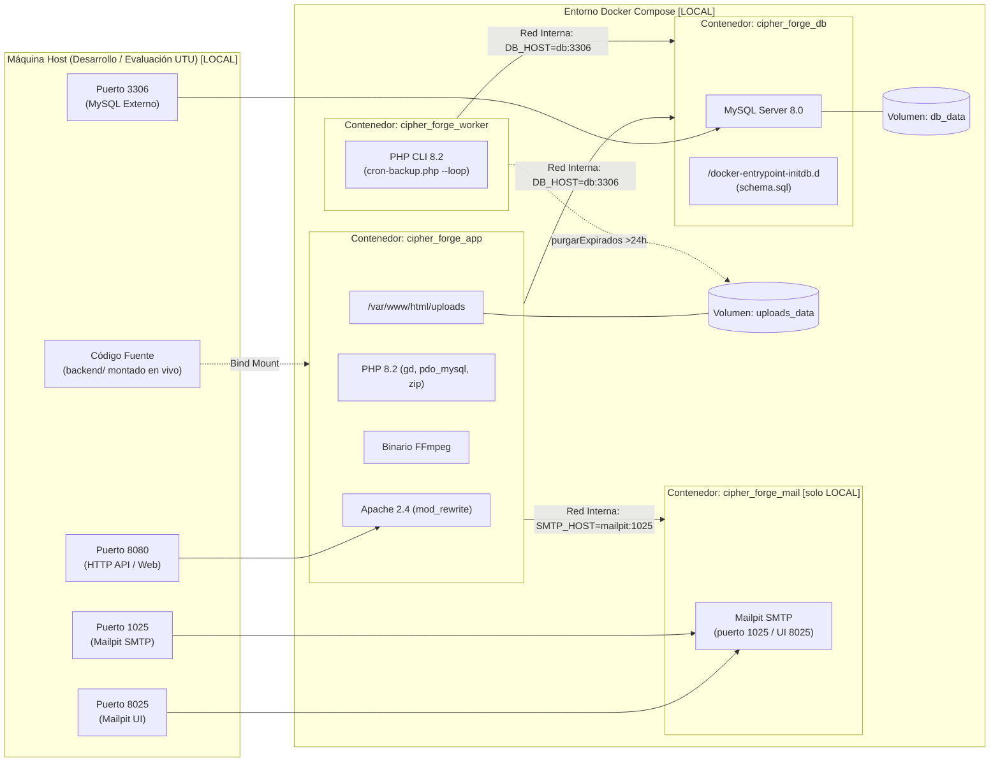
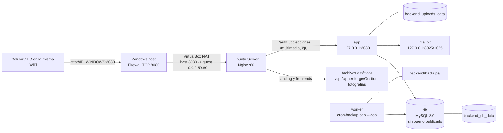

# Documentación de Infraestructura y Contenedores

> **Convenciones:** `COMPARTIDO` = lógica válida en todos los entornos. `LOCAL` = desarrollo/testing/evaluación UTU en Windows con Docker Desktop. `SERVIDOR UBUNTU` = entorno implementado en la VM `Ubuntu-Server-Lab` con Nginx, VirtualBox NAT y Docker Compose; se usa como demo/laboratorio, no como producción. `PRODUCCIÓN` = entorno real, no implementado. Todo lo no decidido figura como `PENDIENTE DE DEFINICIÓN`.
>
> **Rol del documento:** referencia técnica de arquitectura e infraestructura. Los pasos de reconstrucción viven en [guia_reconstruccion.md](guia_reconstruccion.md). No duplicar pasos aquí.
>
> **Documento relacionado:** [manual-migracion-serverubuntu.md](manual-migracion-serverubuntu.md) contiene el runbook completo del Server Ubuntu, la configuración de Nginx y la puesta a punto del QR.
>
> **Arquitectura implementada vs propuesta:** las [secciones 1-3](#1-visión-general-de-la-infraestructura-compartido-en-lógica-local-en-valores) describen hechos comprobados del stack local y del Server Ubuntu. La [sección 5](#5-arquitectura-y-requisitos-de-producción-producción--brechas-no-hechos) describe brechas y trabajo necesario, no una arquitectura aprobada. Ver la [sección 6](#6-riesgos-restricciones-y-decisiones-pendientes) para decisiones pendientes.

Este documento detalla la arquitectura de infraestructura basada en contenedores Docker para **Cipher_Forge**: servidor web, PHP, MySQL y persistencia. Salvo indicación `PRODUCCIÓN`, describe el stack local y el Server Ubuntu. El repo local y el servidor no comparten exactamente la misma configuración de Compose: la diferencia se detalla en la [sección 3](#3-especificación-de-docker-compose-backenddocker-composeyml-local-y-servidor-ubuntu).

---

## 1. Visión General de la Infraestructura [COMPARTIDO en lógica, LOCAL en valores]

La infraestructura local se define en `backend/` con `Dockerfile` y `docker-compose.yml` (ver [Sección 2](#2-especificación-del-dockerfile-backenddockerfile-compartido-con-notas-producción) y [Sección 3](#3-especificación-de-docker-compose-backenddocker-composeyml-local-y-servidor-ubuntu)). Lógica compartida con producción: API PHP + MySQL 8.0 + almacenamiento en `uploads/` + worker de respaldo/purga. Valores, red y secretos descritos son locales.

> **Nota:** en producción no hay bind mount, ni Mailpit, ni puertos DB/SMTP publicados, ni HTTP sin TLS. Ver [Sección 5](#5-arquitectura-y-requisitos-de-producción-producción--brechas-no-hechos).

---

## 2. Especificación del Dockerfile (`backend/Dockerfile`) [COMPARTIDO con notas PRODUCCIÓN]

<!-- WHAT: Imagen PHP 8.2 + Apache. WHY: Empaqueta FFmpeg/GD/pdo_mysql sin contaminar el host. HOW: Base oficial php:8.2-apache sobre Debian. -->

> **Nota de trazabilidad:** FFmpeg, Docker y filesystem implementan la épica EP4 de [01-requerimientos.md, Épicas](01-requerimientos.md#13-definición-de-épicas) (redactada en general por CC-08). Ver [02-modelado.md, Capas](02-modelado.md#13-descripción-detallada-de-capas).

### 2.1 Código y desglose

La imagen parte de `php:8.2-apache` (Debian), instala FFmpeg, `default-mysql-client`, GD con FreeType/JPEG, `pdo_mysql` y `zip`, y habilita `mod_rewrite`. Copia `php.ini` como `99-cipher-forge.ini` y el entrypoint; el comando por defecto es Apache.

> **Código de la aplicación:** el `Dockerfile` no copia `src/`, `public/`, `routes.php` ni el resto del backend. En local el código llega por el bind mount `.:/var/www/html` de `app` y `worker`. Una imagen inmutable para producción debe incorporar el código en el build (`COPY`/multi-stage) antes de eliminar ese bind mount.

El entrypoint crea `uploads/originals`, `uploads/previews` y `uploads/standard` con `www-data:www-data 775`, espera a MySQL y aplica `database/migration.sql` de forma idempotente en cada arranque; luego ejecuta `exec "$@"`.

> **Notas PRODUCCIÓN:**
> * Sin `USER`: el contenedor corre como root (hallazgo SAST vigente). `PENDIENTE DE DEFINICIÓN`: usuario no privilegiado.
> * `AllowOverride` debe permitir `.htaccess` de `uploads/` y `backups/` (`Require all denied`), o migrar la denegación a config del servidor.
> * En producción la imagen debe ser inmutable (sin bind mount) y versionada para rollback. `PENDIENTE DE DEFINICIÓN`.

### 2.2 Límites del runtime (CF-NUEVO) [COMPARTIDO]

`backend/php.ini` como `99-cipher-forge.ini`:

| Directiva | Valor local | Justificación |
|---|---|---|
| `file_uploads` | On | Subidas habilitadas |
| `upload_max_filesize` | 900M | Video 800 MB + margen (`MultimediaValidator::MAX_VIDEO`) |
| `post_max_size` | 1G | Multipart con varias fotos |
| `memory_limit` | 512M | GD + FFmpeg |
| `max_execution_time` / `max_input_time` | 600 | Videos 800 MB |

> Nivel transporte, mientras CF-03 valida por tipo en aplicación (`MultimediaValidator`). Ver `02-modelado.md` y CC-16. En producción estos valores implican riesgo DoS sin throttling/cuotas (ver [Sección 5.5](#55-validación-errores-y-exposición), [Sección 5.11](#511-rendimiento-disponibilidad-privacidad-y-mantenimiento)).

---

## 3. Especificación de Docker Compose (`backend/docker-compose.yml`) [LOCAL y SERVIDOR UBUNTU]

Cuatro servicios en red puente: `app`, `mailpit` (solo desarrollo), `worker`, `db`. `app` y `worker` comparten imagen `cipher-forge:dev`.

> **Dos configuraciones distintas:** el `backend/docker-compose.yml` del repo local describe `LOCAL Windows`; el Server Ubuntu usa la versión corregida del [manual de migración, sección 4.3](manual-migracion-serverubuntu.md#43-corregir-docker-composeyml). No son equivalentes. La versión de Ubuntu limita `app` a `127.0.0.1:8080`, no publica `db` ni Mailpit y toma secretos/URLs desde `.env`.

### 3.1 Servicios definidos [LOCAL Windows]

Fuente: `backend/docker-compose.yml` del repo actual. Esta configuración es la que se usa para desarrollo local con Docker Desktop; no es la que corre en el Server Ubuntu.

#### A. `app` (`cipher_forge_app`)

* **Build/imagen:** `./Dockerfile` → `cipher-forge:dev`.
* **Puertos:** `8080:80` (HTTP, sin TLS, publicado en todas las interfaces).
* **Volúmenes:** `.:/var/www/html` (bind mount solo-local) + `uploads_data:/var/www/html/uploads`.
* **Env:** `DB_HOST=db`, `DB_NAME=cipher_forge`, `DB_USER=cipher_user`, `DB_PORT=3306`; `FRONTEND_URL=http://localhost:5501/Gestion-fotografias`; `SMTP_HOST=mailpit`, `SMTP_PORT=1025`, `MAIL_FROM`, `MAIL_FROM_NAME`; `COOKIE_NAME=cipher_forge_token`, `COOKIE_SECURE=false` (HTTP), `COOKIE_SAMESITE=Strict`; `SISTEMA_ALLOWED_IPS` solo como comentario opcional. El compose del repo **no declara `DB_PASS` ni `JWT_SECRET`**; esa es una brecha del entorno local, no de la configuración de Ubuntu. Credenciales de desarrollo, no usar en producción.
* **Depende:** `db`, `mailpit`. **Sin `restart:`** (a diferencia de `worker: unless-stopped`, `mailpit/db: always`).

#### B. `mailpit` (`cipher_forge_mail`) [solo LOCAL]

`axllent/mailpit:latest` (CF-02 / RF18). Puertos `8025:8025` (UI) y `1025:1025` (SMTP). El compose local los publica en todas las interfaces; “nada sale de la máquina” solo es cierto si el firewall del host lo impide o si se cambia el binding a `127.0.0.1`. **No desplegar en producción.**

#### C. `worker` (`cipher_forge_worker`)

Misma imagen. `command: php cron-backup.php --loop` (CF-12): respaldo diario (HU13/RNF5-RNF7) + purga colaborativa >24h (HU12/RF15). Sin puertos. Volúmenes código + `uploads_data`. Env `DB_*` + `BACKUP_INTERVAL_SEG=86400`, `PURGE_INTERVAL_SEG=3600`. `restart: unless-stopped`. `depends_on: [db]`.

#### D. `db` (`cipher_forge_db`)

`mysql:8.0`. Puerto `3306:3306` publicado (conveniencia local, en todas las interfaces). Env `MYSQL_ROOT_PASSWORD` y `MYSQL_DATABASE` sin valor explícito en el compose (se resuelven desde el entorno o `.env`), `MYSQL_USER=cipher_user`; el compose actual **no declara `MYSQL_PASSWORD`**. Volúmenes `db_data:/var/lib/mysql` + `./database/schema.sql:/docker-entrypoint-initdb.d/schema.sql` (solo primera vez del volumen). En un volumen nuevo, la falta de `MYSQL_PASSWORD` impide una inicialización correcta; la versión de Ubuntu lo corrige.

### 3.2 Servicios definidos [SERVIDOR UBUNTU]

Fuente: [manual de migración, sección 4.3](manual-migracion-serverubuntu.md#43-corregir-docker-composeyml). El compose se aplica en `/opt/cipher-forge/Gestion-fotografias/backend/docker-compose.yml` dentro de la VM.

| Servicio | Configuración en el Server Ubuntu |
|---|---|
| `app` | Imagen `cipher-forge:dev`; `restart: unless-stopped`; puerto `127.0.0.1:8080:80`; volúmenes `.:/var/www/html` y `uploads_data:/var/www/html/uploads`; `DB_PASS=${MYSQL_PASSWORD}`, `JWT_SECRET=${JWT_SECRET}`, `FRONTEND_URL=${FRONTEND_URL}`, SMTP `mailpit:1025`, cookies `COOKIE_SECURE=false` y `COOKIE_SAMESITE=Strict`; depende de `db` y `mailpit`. |
| `worker` | Misma imagen; `restart: unless-stopped`; `command: php cron-backup.php --loop`; volúmenes de código y `uploads_data`; `DB_PASS=${MYSQL_PASSWORD}`, `BACKUP_INTERVAL_SEG=86400`, `PURGE_INTERVAL_SEG=3600`; depende de `db`. |
| `mailpit` | `axllent/mailpit:latest`; `restart: unless-stopped`; puertos `127.0.0.1:8025:8025` y `127.0.0.1:1025:1025`; acceso por túnel SSH. |
| `db` | `mysql:8.0`; `restart: unless-stopped`; **sin puertos publicados**; `MYSQL_ROOT_PASSWORD`, `MYSQL_DATABASE`, `MYSQL_USER` y `MYSQL_PASSWORD` desde `.env`; volúmenes `db_data:/var/lib/mysql` y `./database/schema.sql:/docker-entrypoint-initdb.d/schema.sql`. |
| Volúmenes | Nombres lógicos `db_data` y `uploads_data`; nombres físicos en este host: `backend_db_data` y `backend_uploads_data`. |
| `.env` | `MYSQL_ROOT_PASSWORD`, `MYSQL_DATABASE=cipher_forge`, `MYSQL_USER=cipher_user`, `MYSQL_PASSWORD`, `JWT_SECRET`, `FRONTEND_URL=http://IP_WINDOWS:8080`. El archivo debe quedar con permisos `600`. |

### 3.3 Tabla comparativa de entornos

| Aspecto | LOCAL Windows (repo actual) | SERVIDOR UBUNTU (implementado) | PRODUCCIÓN (requerido, `PENDIENTE DE DEFINICIÓN` donde aplique) |
|---|---|---|---|
| Entrada web | Apache `:8080` directo | Windows `:8080` → VirtualBox → Nginx `:80` → `app` en `127.0.0.1:8080` | HTTPS con terminación TLS |
| `app` | `8080:80`, sin `restart` | `127.0.0.1:8080:80`, `restart: unless-stopped` | Imagen inmutable, sin bind mount |
| `db` | `3306:3306` publicado | Sin puerto publicado; solo red interna | MySQL sin puerto público |
| Mailpit | `8025:8025`, `1025:1025` publicados | `127.0.0.1:8025/1025` + túnel SSH | Sin Mailpit; SMTP real con TLS |
| Código | Bind mount `.:/var/www/html` | Bind mount `.:/var/www/html` | Imagen inmutable versionada |
| Frontend | Live Server `:5501`; `API_URL=http://localhost:8080` | Nginx sirve los frontends; `API_URL=""` en ambos `config.js` | Origen HTTPS fijo; `API_URL`/`FRONTEND_URL` como parámetros |
| `FRONTEND_URL` | `http://localhost:5501/Gestion-fotografias` | `http://IP_WINDOWS:8080` (ejemplo actual: `http://10.244.239.215:8080`) | Dominio HTTPS |
| Cookies | `COOKIE_SECURE=false`, `SameSite=Strict` | `COOKIE_SECURE=false`, `SameSite=Strict`, mismo origen vía Nginx | `COOKIE_SECURE=true`; topología mismo-site vs cross-site `PENDIENTE DE DEFINICIÓN` |
| Secretos | Compose con valores de desarrollo; `.env` local sin asignaciones activas | `.env` obligatorio, `600`, con `MYSQL_*`, `JWT_SECRET` y `FRONTEND_URL` | Secretos fuera de repo/imagen |
| Supervisión | `app` sin `restart`, sin healthcheck | `restart: unless-stopped`; sin healthcheck | `restart` + healthcheck (`/api/ping` no chequea BD) |
| Nginx | No se usa | Nginx `:80`, estáticos + proxy a `127.0.0.1:8080`; deniega `/backend`, `/docs` y `/sistema` | Nginx/TLS o proxy equivalente `PENDIENTE DE DEFINICIÓN` |
| QR | `FRONTEND_URL` local; QR con `localhost` | `FRONTEND_URL` público; QR validado desde celular el 28/10/2026 | Dominio HTTPS y QR regenerados |

### 3.4 Entorno Server Ubuntu: topología, Nginx y operación

**Topología implementada:**

**Configuración Nginx:** la del [manual, sección 6.1](manual-migracion-serverubuntu.md#61-crear-el-sitio), confirmada como idéntica en este entorno:

- `root /opt/cipher-forge/Gestion-fotografias`; `/` redirige a `/lading-page/paginaprincipal.html`.
- Sirve `frontend-cliente/`, `frontend-fotografo/` y `lading-page/` como estáticos.
- Proxya `/auth`, `/fotografos?`, `/colecciones`, `/multimedia`, `/invitaciones`, `/hashtags`, `/favoritos`, `/colaborativo`, `/qr` y `/api` a `http://127.0.0.1:8080`.
- Deniega `/backend`, `/docs`, archivos ocultos, `.env`, `.sql`, `.md`, `.yml`, `.yaml`, `.ini`, `.log`, `.sh` y `/sistema`.
- `client_max_body_size 900m`; `proxy_read_timeout` y `proxy_send_timeout` en `600s`; `Host $http_host` para conservar el puerto público.
- Nginx conserva el puerto `8080` que ve el celular; no se debe perder con `$host`.

**Rutas, puertos y acceso:**

| Elemento | Valor actual |
|---|---|
| VM | `Ubuntu-Server-Lab`, IP interna NAT `10.0.2.50` |
| Windows | IP WiFi `10.244.239.215`; puerto público `8080`; firewall TCP 8080 para `LocalSubnet` |
| SSH | `ssh -p 2222 USUARIO@127.0.0.1`; en este entorno `USUARIO=sysadmin` |
| Mailpit | `ssh -p 2222 -L 8025:127.0.0.1:8025 sysadmin@127.0.0.1` y abrir `http://localhost:8025` |
| phpMyAdmin | Regla VirtualBox `127.0.0.1:8081` (sin cambios) |
| Proyecto | `/opt/cipher-forge/Gestion-fotografias` |
| Backups | `/opt/cipher-forge/Gestion-fotografias/backend/backups/`, owner `33:33`, permisos `775` |
| QR | Validado desde un celular real el 28/10/2026; URL esperada `http://10.244.239.215:8080/frontend-cliente/pages/colaborativo.html?token=...` |

**Dependencias de red y operación:**

- En NAT, Windows debe permanecer encendido porque provee la IP de la WiFi y el port forwarding; la VM solo no es accesible desde el celular.
- La VM debe estar corriendo. El arranque automático con Windows no está confirmado; si no se configura autostart en VirtualBox, hay que abrirla manualmente.
- La IP `10.244.239.215` es la actual; reservarla en el router/DHCP sigue recomendado. Si cambia, hay que actualizar `FRONTEND_URL` y regenerar los QR.
- Si se pasa a Bridged, la VM obtiene IP propia en la LAN, el celular entra a `http://IP_UBUNTU` por el puerto 80 y Windows deja de ser necesario como puerta.
- Mailpit no se publica a la LAN: se consulta por túnel SSH.
- El detalle completo de migración, restauración y pruebas vive en [manual-migracion-serverubuntu.md](manual-migracion-serverubuntu.md).

---

## 4. Scripts y mecanismos de persistencia [COMPARTIDO en lógica]

### 4.1 Esquema (`backend/database/schema.sql`) [COMPARTIDO]

11 tablas (`backend/database/schema.sql`): `usuarios` (padre), `clientes` y `fotografos` (FK 1:1 a `usuarios.id`), `colecciones` (`fotografo_id` → `usuarios.id`), `multimedia` (`coleccion_id` → `colecciones.id`), `favoritos` (`usuario_id` → `usuarios.id`; `favorito_id` → `colecciones.id`, CC-15), `acceso_colecciones`, `qr_tokens` (token colaborativo con expiración a 24 h o de acceso), `hashtags`, `coleccion_hashtags` y `backups`. Todas las FK usan `ON DELETE CASCADE`; `usuarios.email` es `UNIQUE`.

> **Nota (fragilidad de nombres, no bloqueante):** la redefinición de la FK de `favoritos` en `backend/database/migration.sql` depende del nombre exacto del constraint `favoritos_ibfk_2` (MySQL lo autogenera y ese nombre puede variar entre versiones/instalaciones); si difiriera, la migración fallaría o no aplicaría el cambio. Correcta en el stack local actual; verificar antes de producción.

### 4.2 Respaldo diario y rotación (RNF5,RNF6,RNF7) [COMPARTIDO en lógica, LOCAL y SERVIDOR UBUNTU en almacenamiento]

Solución autocontenida PHP para el backup de la aplicación, sin `mysqldump` ni cron del host: `App\services\BackupService` + `backend/cron-backup.php` (CF-12). El `mysqldump` se usa en otro mecanismo: el dump de migración y el backup completo del [manual, secciones 3.3 y 10.6](manual-migracion-serverubuntu.md#33-generar-el-dump-de-la-base).

* **Worker (recomendado local):** `php cron-backup.php --loop` (respaldo diario + purga horaria).
* **One-shot:** `php cron-backup.php` (manual/cron host).
* **API:** `POST /sistema/backup`, `GET /sistema/backups` (restringidos por `SistemaController::restringirALocal`, H02).

Volcados en `backend/backups/backup_cipher_forge_{YYYY-MM-DD_HH-mm-ss}.sql`.

**Componentes:**

1. **`backend/backups/`:** resuelto por `App\Core\Config::backupsDir()`. Protegido por `backend/backups/.htaccess` (`Require all denied`, H01). Tres volcados versionados en git pese a `backend/.gitignore` — no versionar respaldos.
2. **`BackupService`:** volcado PDO (`SHOW FULL TABLES`, `SHOW CREATE TABLE`, `$pdo->quote()`), excluye `backups`, rotación FIFO a 3 copias, auditoría en tabla `backups` (`NOW()`).
3. **`cron-backup.php`:** intervalos por entorno (`BACKUP_INTERVAL_SEG`, `PURGE_INTERVAL_SEG`), `MultimediaService::purgarExpirados` + `generarBackup`.
4. **API (`backend/routes.php`):** `POST /sistema/backup`, `GET /sistema/backups`, `POST /sistema/limpiar-colaborativos`.

### 4.3 Respaldos en el Server Ubuntu (estado actual)

| Mecanismo | Estado |
|---|---|
| Backup de la app con `BackupService` / `cron-backup.php` | One-shot ejecutado con `docker compose exec -T app php cron-backup.php` y verificado en `backend/backups/`; la ejecución programada del `worker` no está confirmada. |
| Restore de un backup de la app | Procedimiento documentado en el [manual, sección 10.4](manual-migracion-serverubuntu.md#104-restaurar-un-backup-de-la-app-en-una-base-de-prueba); no ejecutado en este entorno. |
| Dump completo con `mysqldump` | Procedimiento documentado en el [manual, sección 10.6](manual-migracion-serverubuntu.md#106-recomendación-backup-completo-adicional); no confirmado como programado. |
| Copia off-site en `/srv/backups/cipher-forge` | Procedimiento documentado en el [manual, sección 10.3](manual-migracion-serverubuntu.md#103-copiar-los-respaldos-fuera-del-servidor); no confirmado como configurado. |
| Backups viejos de Windows | Conservados; la rotación del worker puede reemplazarlos si se deja correr sobre el mismo directorio. |

* **Ubicación en Ubuntu:** `/opt/cipher-forge/Gestion-fotografias/backend/backups/`.
* **Permisos:** owner `33:33` (`www-data` en la imagen PHP/Apache) y modo `775`.
* **Rotación:** FIFO a 3 copias; el backup de la app excluye la tabla `backups`.
* **Diferencia con el dump de migración:** el backup de la app es PDO y excluye `backups`; el dump de migración/full backup usa `mysqldump` y sí incluye la tabla `backups`.

> **Límites para producción (ver [Sección 5.8](#58-copias-de-seguridad-y-recuperación)):** sin transacción consistente (riesgo con escritura concurrente), solo disco local; el off-site y el restore están documentados en el manual, pero no verificados en este entorno. `rotarBackups` borra físico aun si `unlink` falla.

---

## 5. Arquitectura y requisitos de producción [PRODUCCIÓN — brechas, no hechos]

> Nada de esta sección está implementado ni aprobado como decisión de despliegue. Cada ítem indica estado actual, trabajo necesario y clasificación BLOQUEANTE / NECESARIA / RECOMENDADA / PENDIENTE DE DECISIÓN.

### 5.1 Configuración por entorno y secretos

* **Actual LOCAL Windows:** `environment:` con valores de desarrollo; `backend/.env` existe pero no tiene asignaciones activas y el código PHP no lo carga (solo `getenv()` en `Database`, `Config`, `Mailer` y `CookieAuth`); `.env.example` incompleto (omite `SMTP_*`); `JWT_SECRET` ausente → autogenerado en `uploads/.jwt_secret` (`Config::jwtSecret()`, `0600`).
* **Actual SERVIDOR UBUNTU:** Docker Compose **sí** lee `backend/.env` para interpolar `MYSQL_*`, `JWT_SECRET` y `FRONTEND_URL`; el código PHP sigue usando `getenv()`. El `.env` es obligatorio, debe quedar con permisos `600` y no se copia desde Windows. `JWT_SECRET` está definido en `.env`, por lo que no se usa el fallback de `uploads/.jwt_secret`.
* **Requerido:** secretos fuera de repo/imagen; `JWT_SECRET` obligatorio (multi-réplica imposible sin secreto compartido); plantilla completa. **BLOQUEANTE.** Valores reales `PENDIENTE DE DEFINICIÓN`.

### 5.2 Servidor, HTTPS, CORS y red

* **Actual LOCAL Windows:** Apache HTTP `:80` dentro del contenedor, publicado como `:8080`; `backend/public/index.php` emite `Access-Control-Allow-Origin: *` a orígenes no locales; expone `Content-Disposition, Content-Length`; `COOKIE_SECURE=false` y `SameSite=Strict`. Esta configuración es válida para evaluación UTU con HTTP sin TLS.
* **Actual SERVIDOR UBUNTU:** Nginx HTTP `:80` como borde; `app` solo en `127.0.0.1:8080`; frontend y API comparten origen, por lo que el navegador no hace CORS. El backend sigue emitiendo `Access-Control-Allow-Origin: *`, pero no es alcanzable directamente desde la LAN. `COOKIE_SECURE=false` porque el entorno es HTTP de laboratorio; no hay TLS ni dominio.
* **Requerido (producción):** TLS + HSTS + `COOKIE_SECURE=true`; CORS con lista cerrada (un solo `FRONTEND_URL` insuficiente para múltiples orígenes); sin puertos DB/SMTP públicos; cabeceras de seguridad. **BLOQUEANTE** (CORS `*`, sin TLS). Elección TLS/proxy `PENDIENTE DE DEFINICIÓN`.

### 5.3 Persistencia y almacenamiento de fotografías

* **Actual LOCAL Windows:** fotos y base de datos viven en dos volúmenes Docker (`uploads_data` con `originals/`, `previews/`, `standard/`; y `db_data` con MySQL). `docker compose down -v` borra ambos volúmenes. Los volcados SQL de `backend/backups/` están en el host y sobreviven a ese comando, pero no hay copia **off-site** ni respaldo de los binarios de `uploads`: si se pierde el host, se pierden originales y respaldos. Nombres de archivo aleatorios (`bin2hex(random_bytes(16))`, `MediaProcessor`): no se adivinan por URL. El acceso directo HTTP está denegado por `.htaccess` (`Require all denied`), condición que depende de que Apache tenga `AllowOverride` habilitado.
* **Actual SERVIDOR UBUNTU:** los mismos dos volúmenes, con nombres físicos `backend_db_data` y `backend_uploads_data`. `docker compose down -v` sigue siendo destructivo y borra fotos y base; los backups de `backend/backups/` están en el filesystem de la VM y sobreviven, pero siguen en el mismo host. Los binarios de `uploads` **no** están cubiertos por el backup de la aplicación. Nginx deniega `/backend` y las extensiones sensibles, por lo que el acceso directo a originales no depende solo de `.htaccess` en este entorno. La copia off-site a `/srv/backups/cipher-forge` está documentada en el [manual, sección 10.3](manual-migracion-serverubuntu.md#103-copiar-los-respaldos-fuera-del-servidor), pero no confirmada como configurada.
* **Requerido:** (1) persistencia gestionada: copias automáticas del proveedor de volúmenes o sustituirlos por almacenamiento externo; (2) snapshots periódicos del estado, incluidos los binarios de `uploads`; (3) decidir migración a Object Storage/CDN según volumen/retención (decisión P5, `PENDIENTE DE DEFINICIÓN`); (4) verificar `AllowOverride` en producción o trasladar la denegación a la config del servidor. **NECESARIA.**

### 5.4 Autenticación, autorización y permisos

* **Actual:** JWT HS256 24h (`backend/src/helpers/Jwt.php`, `backend/src/Core/Config.php`), cookie HttpOnly + Bearer + fallback `?token=` (`backend/src/middlewares/AuthMiddleware.php`); regla central `verificarAccesoALaColeccion` (`backend/src/services/MultimediaService.php`); logout stateless; **rate limiting en endpoints de auth desde 2026-10-21** (`backend/src/middlewares/RateLimitMiddleware.php`: `/auth/login` 5/60 s por IP+email y 20/5 min por IP, `/auth/register` 10/h por IP, `/auth/verificar-email` 6/10 min por IP+email, `/auth/reenviar-codigo` 3/15 min por IP+email y 10/h por IP, `429` + `Retry-After`; ver [implementaciones-futuras.md, Sección 4](implementaciones-futuras.md#4-rate-limiting-global-para-todas-las-rutas) para el alcance global pendiente — subidas y escritura siguen sin tasa, ver [Sección 5.6](#56-dependencias-y-ejecución)); `GET /fotografos` y `GET /fotografos/{id}` públicos con email/teléfono (`backend/src/repository/UserRepository.php`).
* **Actual SERVIDOR UBUNTU:** el rate limiting por IP se vuelve **compartido** detrás de Nginx: si Nginx no reenvía la IP real del cliente (`X-Forwarded-For`), todos los usuarios de la LAN podrían contarse como una sola IP y agotar el límite entre ellos. En este entorno no se configuró `real_ip`/`X-Forwarded-For`; el tráfico llega desde `127.0.0.1`. `/sistema/*` se deniega en Nginx, no en la aplicación. `?token=` sigue disponible y es la base del QR validado.
* **Requerido:** eliminar/limitar `?token=`; preservar la IP real detrás de proxy y decidir si el rate limit debe ser por IP+cuenta; lockout de cuenta progresivo como complemento; revisar exposición de datos personales (Ley 18.331, `PENDIENTE DE DEFINICIÓN`); anti-CSRF adicional a `SameSite`. **BLOQUEANTE** (`?token=`) + **NECESARIA** (privacidad, anti-CSRF, IP real detrás de proxy).

### 5.5 Validación, errores y exposición

* **Actual (validación):** sí se valida MIME real y límites de archivo (30 MB / 800 MB), longitudes de título (≤60), descripción (≤90), hashtag (≤40) y teléfono (≤30). Queda la **carrera de duplicado**: dos registros simultáneos con el mismo email chocan con la restricción `UNIQUE` → 500 en lugar de un 409 "email ya registrado".
* **Actual (fuga):** cuando un error escapa al `try/catch`, el manejador responde 500 interpolando `$e->getMessage()` en el JSON (`backend/public/index.php`). Ese mensaje viaja **hasta el cliente de la red**: ahí está la **"fuga" = filtración de información interna del servidor** (fragmentos de SQL, rutas de archivos, nombres de tablas, mensajes de librerías) que un atacante usa para cartografiar el sistema. `display_errors=0` + `register_shutdown_function` en JSON ya evitan fugar HTML/stack traces, pero el `getMessage()` sigue exponiendo detalle interno.
* **Requerido:** (1) carrera de duplicado → 409; (2) 500 con mensaje genérico, sin `$e->getMessage()` (el detalle queda solo en el log del servidor). **BLOQUEANTE** (fuga de información interna en el 500).

### 5.6 Dependencias y ejecución

* **Actual:** sin Composer/npm; `php:8.2-apache`, `mysql:8.0`, `axllent/mailpit:latest` sin pin de versión; GD/FFmpeg síncronos en request (`max_execution_time=600`); subida invitada anónima de hasta 800 MB por video (límite de aplicación) y 1 GB por petición (límite PHP `post_max_size`), sin rate limiting (`backend/routes.php`, `backend/php.ini`).
* **Requerido:** pin de versiones, throttling/cuotas, procesado asíncrono o límites operativos. **BLOQUEANTE** (subida anónima sin tasa).

### 5.7 Migraciones y consistencia

* **Actual:** `backend/database/schema.sql` + `backend/database/migration.sql` idempotente con `information_schema`, aplicado en cada arranque por `backend/docker-entrypoint.sh` **sin lock ni job único**: si hubiera varias instancias arrancando a la vez, todas aplicarían la misma migración en paralelo. En el stack actual de réplica única no produce incidencias.
* **Requerido:** migración versionada (esquema bajo control de versiones) con lock o job único que garantice que **solo una instancia** aplique cada migración por arranque, esperando el resto. `PENDIENTE DE DEFINICIÓN` (exigible solo antes de escalar a réplicas). **NECESARIA.**

### 5.8 Copias de seguridad y recuperación

* **Actual LOCAL Windows:** hasta 3 copias `backup_cipher_forge_*.sql` en `backend/backups/` (rotación FIFO), auditoría en la tabla `backups`. La purga colaborativa se ejecuta cada 1 h y elimina archivos no aprobados con más de 24 h; no es una purga de respaldos cada 24 h.
* **Actual SERVIDOR UBUNTU:** backup one-shot ejecutado y verificado; el `worker` programado no está confirmado. Restore y copia off-site están documentados, no ejecutados en este entorno. Los backups viejos de Windows se conservaron. Ver [Sección 4.3](#43-respaldos-en-el-server-ubuntu-estado-actual).
* **Tres carencias (ambos entornos):**
  * **Sin off-site confirmado:** las copias están en el *mismo* disco/máquina que la base de datos original; un incendio o borrado del host destruye original y respaldos a la vez.
  * **Sin consistencia transaccional:** el volcado lee tabla por tabla mientras la aplicación sigue escribiendo; si cae entre la lectura de `colecciones` y la de `multimedia`, la copia queda "a medias" (datos inconexos entre tablas relacionadas) y una restauración produciría referencias rotas.
  * **Sin restore probado:** nadie verificó que esos `.sql` se restauran ni cuánto tardan; una copia nunca restaurada se asume correcta sin evidencia.
* **Requerido:** (1) copias fuera del servidor (**off-site**); (2) definir **RPO** (pérdida máxima de datos tolerable — la copia actual es diaria ⇒ hasta 24 h de pérdida) y **RTO** (tiempo en volver el servicio); (3) **restore probado** sobre entorno limpio, documentado en un **runbook** (procedimiento paso a paso de recuperación); (4) respaldar también los binarios de `uploads`. Decisión P6, `PENDIENTE DE DEFINICIÓN`. **BLOQUEANTE.**

### 5.9 Logs, monitorización y diagnóstico

* **Actual LOCAL Windows:** la única forma de mirar qué pasa es `docker compose logs` (texto libre) y `GET /api/ping`, que responde 200 solo si Apache/PHP están vivos **sin consultar la base de datos**: con MySQL caído, el ping sigue "verde" mientras todos los endpoints con BD fallan. No hay métricas ni alertas.
* **Actual SERVIDOR UBUNTU:** se suman los logs de Nginx (`/var/log/nginx/access.log` y `error.log`) y los del sistema (`journalctl`). `app` tiene `restart: unless-stopped`, pero sigue **sin healthcheck**. Mailpit se consulta por túnel SSH, no tiene panel expuesto a la LAN.
* **Dos conceptos distintos:**
  * **Salud (*health*):** saber *en este momento* si el servicio y sus dependencias (BD, disco) responden. Por eso lo pedido es un healthcheck que pruebe la BD real, más `restart` en `backend/docker-compose.yml` para que Docker reinicie `app` automáticamente si se queda colgada.
  * **Observabilidad:** entender *lo que ha pasado* y ver tendencias: logs en formato estructurado (JSON, parseables por herramientas), métricas (peticiones/s, latencias, errores 4xx/5xx, disco) y alertas que notifiquen a una persona ante umbrales.
* **Requerido:** healthcheck con verificación de BD, logs estructurados, monitorización con alertas; herramienta a elegir `PENDIENTE DE DEFINICIÓN`. **NECESARIA** (salud) + **RECOMENDADA** (observabilidad).

### 5.10 Despliegue, post-despliegue y reversión

* **Actual LOCAL Windows:** `compose up --build -d`, `stop/start`, `down -v` (destructivo). La imagen local se construye con tag `cipher-forge:dev` y el código llega por bind mount; el `Dockerfile` no copia la aplicación.
* **Actual SERVIDOR UBUNTU:** el mismo modelo de bind mount sobre `/opt/cipher-forge/Gestion-fotografias`; los cambios se aplican con `git pull`/copia y `docker compose up -d --build`. No hay pipeline, ni imágenes versionadas, ni rollback probado. El procedimiento de migración y las comprobaciones están en [manual-migracion-serverubuntu.md](manual-migracion-serverubuntu.md).
* **Requerido:** imagen inmutable versionada (tag de versión, código incluido en el build, sin bind mount), migración controlada, comprobaciones ([guia_reconstruccion.md, Sección 2.4](guia_reconstruccion.md#24-comprobaciones-posteriores-producción)), rollback de aplicación por tag y de datos por snapshot/restore. `docker logs` sigue disponible; la inmutabilidad no impide `docker exec`/`docker cp` para diagnóstico ni convierte el contenedor en solo lectura, y no sustituye los respaldos off-site (ver [Sección 5.3](#53-persistencia-y-almacenamiento-de-fotografías) y [Sección 5.8](#58-copias-de-seguridad-y-recuperación)). Procedimiento ejecutable `PENDIENTE DE DEFINICIÓN`. **NECESARIA.**

### 5.11 Rendimiento, disponibilidad, privacidad y mantenimiento

Sin paginación en listados; FFmpeg/GD síncronos; `memory_limit=512M`; divergencia horaria PHP/MySQL (`time()` vs `NOW()`); `app` sin `restart`. Privacidad: directorio público con datos de contacto. **NECESARIA** (paginación, TZ, restart) + **RECOMENDADA** (rendimiento, headers).

### 5.12 Pruebas antes de producción

Existente (equipo, no re-ejecutado aquí): `backend/FAILS-TESTED.md` (62 E2E), `backend/Done.md` (correcciones 2026-09-07), `06-testing.md` (varias `Pendiente de confirmar en navegador`). Exigible: E2E, restauración, carga, revisión SAST con Quality Gate en verde. Criterios `PENDIENTE DE DEFINICIÓN`.

---

## 6. Riesgos, restricciones y decisiones pendientes

**Clasificación:** BLOQUEANTE impide despliegue; NECESARIA debe resolverse por requisito; RECOMENDADA mejora seguridad/operación; PENDIENTE DE DECISIÓN requiere PM/cliente.

> **Alcance de los riesgos:** salvo que se indique lo contrario, describen **PRODUCCIÓN**. El Server Ubuntu es un laboratorio HTTP en LAN: no tiene TLS, dominio ni exposición a internet, y no debe presentarse como producción.

| ID | Riesgo / brecha | Evidencia | Clase |
|---|---|---|---|
| B1 | Sin TLS, `COOKIE_SECURE=false` | `backend/docker-compose.yml`; Nginx del Server Ubuntu solo HTTP | BLOQUEANTE |
| B3 | Subida anónima sin tasa (800 MB por video / 1G por petición) | `backend/routes.php`, `backend/php.ini` | BLOQUEANTE |
| B4 | Secretos dev + `JWT_SECRET` ausente en LOCAL + dumps en git | `backend/docker-compose.yml`, `Config::jwtSecret()`, `git ls-files backups/`; el Server Ubuntu corrige el `.env` | BLOQUEANTE |
| B5 | CORS `*` + fuga 500 + JWT en URL | `backend/public/index.php`, `AuthMiddleware` | BLOQUEANTE |
| B6 | SMTP plano, Mailpit no-prod | `backend/src/helpers/Mailer.php`; Mailpit solo en LOCAL/Server Ubuntu | BLOQUEANTE |
| B7 | Sin restore/off-site/consistencia | `BackupService::generarSqlDump()`; [Sección 4.3](#43-respaldos-en-el-server-ubuntu-estado-actual) | BLOQUEANTE |
| N1 | Sin healthcheck (`/api/ping` no chequea BD); `app` sin `restart` en LOCAL | `backend/docker-compose.yml`, `HomeController` | NECESARIA |
| N2 | Frontend sin hosting; `API_URL` hardcodeada en LOCAL | `frontend-cliente/services/config.js`, `frontend-fotografo/services/config.js`; en Ubuntu se sirve por Nginx con `API_URL=""` | NECESARIA |
| N3 | Carrera de duplicado 409/500, sin paginación, TZ no fijada | `AuthService::register()`, `backend/database/schema.sql` | NECESARIA |
| N4 | Directorio público expone email/teléfono | `UserRepository` | NECESARIA |
| N5 | IP real no preservada detrás de Nginx: rate limit compartido | Nginx del Server Ubuntu sin `X-Forwarded-For`/`real_ip`; [Sección 5.4](#54-autenticación-autorización-y-permisos) | NECESARIA |
| R1 | Root, headers, logs, throttling, sesión 24h tras logout | `backend/Dockerfile`, `backend/public/index.php`, `Jwt`/`Config` | RECOMENDADA |
| R2 | Dependencia de Windows encendido en NAT y VM sin autostart confirmado | VirtualBox NAT y port forwarding; [Sección 3.4](#34-entorno-server-ubuntu-topología-nginx-y-operación) | RECOMENDADA (operación del laboratorio) |

**Decisiones P1-P10 `PENDIENTE DE DEFINICIÓN`:** P1 alcance (¿sustituye exclusión UTU? [01-requerimientos.md, Sección 10, ítem 5](01-requerimientos.md#10-alcance-excluido-para-esta-primera-versión)), P2 proveedor/entorno (sin imponer), P3 dominios/mismo-site, P4 SMTP real, P5 volumen/retención, P6 off-site/RPO-RTO, P7 privacidad directorio, P8 secretos/TLS obligatorios, P9 operador, P10 modelo `/sistema/*` y aceptación/testing. Sin estas no hay diseño final.

**Restricciones:** no exponer secretos en docs; no imponer proveedor/cloud/BD/herramienta; distinguir hecho/deducción/propuesta/pendiente; no declarar pruebas no ejecutadas.

---

## Trazabilidad

* Requisitos: `01-requerimientos.md` (RF7/RF26 30 MB/800 MB, RF15/HU12 purga, HU13/RNF5-RNF7, EP4/EP7, [Sección 10](01-requerimientos.md#10-alcance-excluido-para-esta-primera-versión) excluido prod, RNF4 futuro prod).
* Modelo: [02-modelado.md, Sección 1](02-modelado.md#1-arquitectura-propuesta-del-sistema) y [Sección 2](02-modelado.md#2-modelado-de-datos-diagrama-entidad-relación) (capas, ERD 11 tablas, flujos subida/descarga).
* Seguridad: [03-seguridad.md](03-seguridad.md) (amenazas, Términos, PSI; [Sección 4.1](03-seguridad.md#41-protección-de-endpoints-de-administración-sistema-cf-08--cc-14) sigue como cambio a futuro), Ley 18.331.
* Cambios: CC-11/CCT-11 (worker), CC-14 (postergado `/sistema/*`, R-03), CC-16/CCT-16 (php.ini), CC-27 (30 MB).
* Backend: `backend/routes.php`, `backend/src/Core/Config.php`, `backend/src/Core/Database.php`, `backend/src/middlewares/AuthMiddleware.php`, `backend/src/helpers/Jwt.php`, `backend/src/helpers/CookieAuth.php`, `backend/src/helpers/Mailer.php`, `backend/src/helpers/MediaProcessor.php`, `backend/src/services/BackupService.php`, `backend/cron-backup.php`, `backend/SISTEMA_LOCAL.md`, `backend/EMAIL_CONFIG.md`, `backend/important.md` H01/H02/H09 resueltos.
* Reconstrucción: [guia_reconstruccion.md, Parte 1](guia_reconstruccion.md#parte-1--reconstrucción-y-ejecución-local-local), [Parte 2](guia_reconstruccion.md#parte-2--preparación-y-reconstrucción-en-producción-producción) y [Parte 3](guia_reconstruccion.md#parte-3--reconstrucción-en-server-ubuntu-servidor-ubuntu).
* Migración y operación del laboratorio: [manual-migracion-serverubuntu.md](manual-migracion-serverubuntu.md) (runbook completo, Nginx, backup/restore y validación del QR).

> Estado documental: LOCAL Windows y SERVIDOR UBUNTU reflejan el código/configuración inspeccionados y las pruebas declaradas por el equipo; PRODUCCIÓN sigue siendo un conjunto de brechas no implementadas. Sin ejecución propia del stack Docker ni pruebas propias. La validación del QR desde un celular real (28/10/2026) fue reportada por el equipo, no re-ejecutada en esta revisión documental.
